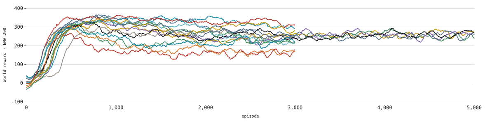
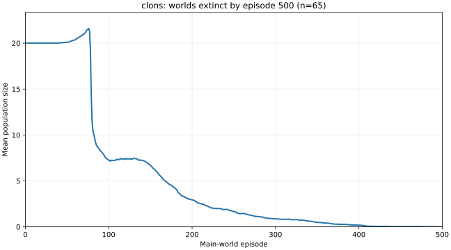
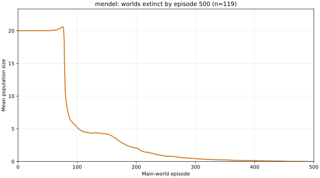
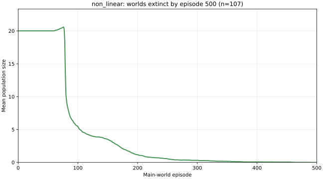
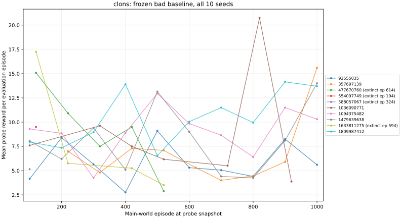
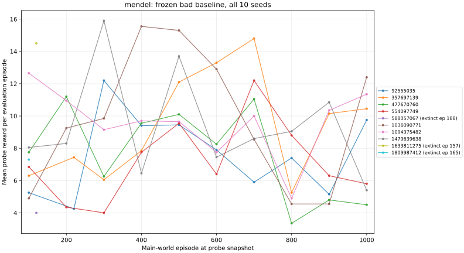
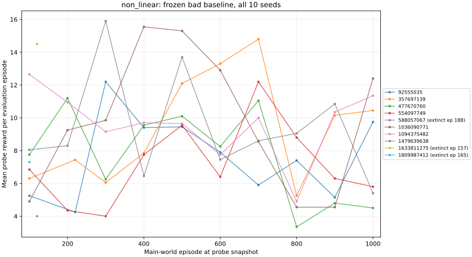

# 03.10.2026
+ **Question:** which genes are worth evolving?
- **Hypothesis and what I expect to see:**
	- I think inheriting the neural-network architecture makes the most sense. This is quite task-specific, and there is never one right answer.
	- But inheriting gamma, I'm sure, will be completely useless. The standard is too good: 0.99 is used everywhere, all the time. I'm sure my task won't be an exception.
## Result, 11.11.26
I dropped this line of research altogether and cut the scope down as much as possible. I'm no longer studying which genes should be passed on. I've kept only the main question: how to pass them on.
Because I don't have an endless budget for all this computation.

# 03.10.2026
+ **Question:** how are genes passed on?
+ **Hypothesis and what I expect to see:** I don't think clones have much of an advantage right now. The "social" interactions are very simplified: there isn't really any partner search or sexual selection. So clones lose their main advantage, which is massive population growth.
	+ I also think non_linear will be one of the most successful. Unlike mendel/clones, it passes genes on very flexibly: it regularly shifts parental values a little, can take something between the two parents, the two best representatives, or go a little outside their range. Clones pass on an exact copy of their own DNA plus mutation (rare, and even more rarely useful: most mutated genes break something, and only a few improve on the pre-mutation version). Mendel differs from non_linear first because it has dominance, so genes keep exactly the dominant parent's value. I see that as a downside: evolution cannot randomly move the number around a small range. Second, every adult stores two values for the same gene. That helps preserve genes and adapt faster, and children differ more because one expresses this gene and another expresses that one. But my environment does not change, so that isn't such a big advantage here. Non_linear also has something similar, except it comes from the formula shifting the number slightly differently each time rather than from different alleles.
	+ The expectation that sexual mechanisms will beat clones is **a consequence of the design, not a pure discovery**. I balanced the world myself: clones pay twice as much as sexual agents, so that the total price of one child is the same for both.

# 31.10.2026

+ So, a problem. I started running new simulations, now the first experiments with evolution on rather than the baseline. Evolution pushes neuron counts way up: from the default 64 to 102-336. That puts a serious load on the computation.

# 01.11.2026
+ I have a problem across all worlds. The first generation gets huge results, really huge, and then something goes wrong during evolution and I don't know why they get worse. A typical curve goes from an average reward of 25 or 30 per adult down to 10 and stays there. Meanwhile the baseline somehow starts at 10 and just stays at 10. I don't get what's going on.
+ I went through the logs and found the pattern. At the very start, adult reward reaches 25 to 35 or 40, then with evolution on it falls to 10 and sits there forever. My plan for experiment number 1 is to switch genes on and off and see which one is responsible. After that I might make the conditions really harsh, so only agents getting around 20 reward survive, effectively twice as harsh a world, and see whether that kills the worlds.
+ Maybe it is limited resources. Even smart agents may simply have nothing left to collect, while the first generation is born into a half-empty world, or rather an empty one.
+ If I find a serious bug, I'll have to recompute the entire baseline.........
+ Okay, I checked. No obvious culprit gene. It is probably just overpopulation.
+ I also worked out the catch: selection only looks at the final reward, not value for computational cost. An agent can be ridiculously expensive, eat up a lot of computing power, and still survive. Parameters such as network size can get so large that they barely matter for this task anymore, but selection still lets them through. I end up with lots of agents with 400 or 500 neurons when about 50 would be enough. They pass selection but use a massive amount of compute. So I'll set an upper limit of 256 neurons in the phenotype.

# 04.11.2026

+ I left an experiment running in the background while doing German, and found something lovely: evolution actually works! Over 1000 episodes:

| gene           | start  | end    | good  |
| -------------- | ------ | ------ | ----- |
| hidden_size    | 40     | 54     | 64    |
| learning_rate  | 0.0009 | 0.0015 | 0.001 |
| curiosity_beta | 1.0    | 1.35   | 1.0   |
| gamma          | 0.50   | 0.51   | 0.99  |

# 06.11.2026
The handicapped genes ALL moved toward the good ones, and gamma has started climbing too!

|**gene**|**start**|**end**|**good**|**verdict**|
|---------------|---------|---------|--------|---------------------------------------------|
|**gamma**|0.50|0.72|0.99|+46% toward good ← used to be stuck, now CLIMBING|
|**buffer_size**|1000|5340|10000|+48% toward good|
|**hidden_size**|40|108|64|OVERSHOOT (networks grew beyond the good setting)|

This is a big deal. It basically means the whole study is on track, because I've already learned the main thing!

And another very important thing I found out: it is enough
to run, say, 5000 episodes. Running 40 000 is completely excessive.

But there is another problem.

|**window**|**adult reward/tick**|**per episode**|**pop**|**gamma**|
|---------------|-------------------|-------------|-------|---------|
|**ep75-500**|0.620|12.4|72|0.563|
|**ep500-1000**|0.605|12.1|89|0.630|
|**ep1000-2000**|0.605|12.1|79|0.690|
|**ep2000-3000**|0.595|11.9|79|0.704|
|**ep3000-3500**|0.597|11.9|80|0.716|

Improving the genes did NOT increase adult reward. At all.

While gamma climbed (0.56 → 0.72) and buffer/hidden improved too, adult reward stayed stuck at ~0.60/tick (~12/ep) for the entire run, even slipping a little (0.620 → 0.597). Population stayed around ~80.

**Problem:** better genes aren't showing up as reward or visible progress in the agents. The genes improve, but mean population reward doesn't rise, population size doesn't rise either; it stays the same or goes slightly down or up.
Yet in frozen worlds the difference is visible, especially at the beginning: the agents learn faster.

- Within the run: gamma rose 0.63→0.72, but population didn't grow. Instead it settled from 89 to ~80 (the early 89 was a transient overshoot, then it corrects toward N*≈80). So better genes didn't raise the ceiling.
- Against the good baseline: better genes give a mean of ~85 versus ~80, a maximum of ~104 versus ~90. That's only ~+6% in the mean and ~+15% in the maximum. A tiny improvement, but not much.

# 07.11.2026

I'll have to change the research design.

Originally I planned to freeze good genes without evolution and get a good baseline, then freeze bad genes for a bad baseline, then run evolution and compare against both baselines to find successful inheritance schemes.

But that doesn't work. In a world where population size is all over the place, the complicated balance makes changes in reward really hard to see.

**Here's what I plan to do:**

Every, say, 100 episodes, I'll save five agents into a special list, freezing their networks and everything needed for their behavior. After the main world ends, I'll create a parallel world for each of them. Each agent will be alone, without death or the energy logic, and it will stop learning. It will keep moving and collecting reward exactly as it was at the moment it was recorded, with all the other things switched off. No other agents, nothing else, just this agent and an empty world. How much it collects should be the fairest possible proxy for its intelligence.

**Technical implementation**

So every N steps we save a checkpoint of Q random adult agents alive at that moment! No agent is picked twice. If there are fewer than Q adults, the script tries again after N_rescue steps, usually a small number so it doesn't distort the curve too much; if there still aren't enough, it takes all available adults. After the main run finishes, a **separate script** loads the snapshots and runs each of the Q agents in a completely empty world where it is the only agent. The world is created using the seed of the original world the agent came from, not its current RNG state, but the untouched world from the start. The network is frozen, with no updates or reproduction, and the agent moves around for P episodes. Q parallel worlds are created, one for each agent, with one agent per world. *(Then each gets its own logs with the agents, rewards, and so on; logging is the same as in the normal world. From that we can plot curves: take the first Q agents, then the second group, then the third, and follow the dynamics.)*

# 08.11.2026
I started the agents with these handicapped genes to leave room for evolution. If they start with good genes, there is nowhere for them to evolve.

|gene|start|good|
|--------------|------|-----|
|hidden_size|40|64|
|learning_rate|0.0009|0.001|
|curiosity_beta|1.0|1.0|
|gamma|0.50|0.99|

At the top of bad_baseline.yml (in the research folder, next to good):
BAD BASELINE
- Learn at ~35-40% of the good baseline's speed.
- Enter adulthood with ~44% less reward.
- Recover to the environment's ceiling by about episode 300.

+ **limitations:** I know I only worsened four genes out of about 16. That might not be entirely fair because I only pulled a few levers, so to speak.
	+ Still, I think it's enough. That's one thing.
	+ More importantly, I can't just choose other bad genes! Changing genes too aggressively makes it easy to get 100% of the worlds to go extinct. This is one of the few settings that produced a visible deterioration while still leaving a good chance of survival.

For the first experiment I used non_linear, 15 seeds, 5 000 episodes.

### <mark style="background: #BBFABBA6;">Evolution is CRYSTAL clear.</mark>

episode   probe reward (intelligence, in isolation)
  100        200   ← bad starting genes
  300        256
  700        326
 1100        356
 1500        401
 1900        379
 2300        409
 2700        407
 3100        403
 3500        416
 3900        416
 4300        417   ← peak number
 4700        365

Probe reward grew from 200 → 417 = +108% (doubled). This is pure skill growth: the same agents, the same solo test, no population or homeostasis. Evolution doubled the agents' intelligence over the run, and you can see it without any noise.

I also realized there is no point running 5000. Three thousand is enough, with room to spare.

----

### Completed

|**mechanism**|**survived**|
|--------------|----------|
|**clones**|12/15|
|**non_linear**|9/15|
|**mendel**|10/15|

Interesting: clones survived best (12 versus 9-10).

----
### Final result - three inheritance schemes, intelligence curve (probe)

|**mechanism**|**ep100**|**ep300**|**ep700**|**ep1100**|**ep1500**|**ep1900**|**ep2300**|**ep2700**|
|--------------|---------|---------|---------|----------|----------|----------|----------|----------|
|**clones**|138|207|264|283|337|355|338|348|
|**mendel**|169|251|339|330|355|351|386|411|
|**non_linear**|154|242|321|345|394|374|406|407|

What this says - a preliminary conclusion:

1. Evolution clearly improves intelligence in all three (×2.5 from the start).
2. The probe idea worked perfectly: normal reward was flat at ~11 for everyone, while the probe shows the actual dynamics.
3. Final intelligence: mendel ≈ non_linear (411 / 407) > clones (348). Sexual inheritance (blending/dominance) gives agents that are ~18% smarter than asexual cloning.
4. But the survival trade-off goes the other way: clones 12/15 > mendel 10 > non_linear 9.

=> Cloning survives a bad start more reliably (fewer extinctions), but has a lower intelligence ceiling.

+ **Hypothesis:** clones survive better because sexual reproduction needs exactly two successful adults, while asexual reproduction needs just one successful agent.
+ **Hypothesis:** sexual agents are smarter because their genes can be tuned more precisely, taking something between the mother's and father's values, especially in non_linear.

### A more precise comparison
Actually, the comparison I just gave wasn't quite right: those weren't the same seeds.

Here is the comparison on matching seeds. It doesn't really change anything, but I needed to check.

|**species**|**ep100**|**ep300**|**ep700**|**ep1100**|**ep1500**|**ep1900**|**ep2300**|**ep2700**|
|--------------|---------|---------|---------|----------|----------|----------|----------|----------|
|**clones**|138|197|288|270|343|360|314|341|
|**mendel**|180|255|354|337|397|338|347|412|
|**non_linear**|108|228|316|342|394|384|384|411|

What changed with the fair comparison

1. clones really does lag in intelligence, and it isn't a sample artifact. Even on the same seeds, the finish is clones 341 versus mendel 412 and non_linear 411. The ~17% gap remains. So asexual cloning produces less intelligent agents in itself, rather than just "keeping more mediocre agents alive."

2. mendel and non_linear are practically indistinguishable (412 versus 411 at the finish). Both forms of sexual inheritance give the same intelligence ceiling.

3. An interesting starting detail: non_linear starts lowest (108). BLX blending gives the most varied, and initially worst, founders, but catches up by ep1100 and then runs level with mendel. clones starts in the middle and gets stuck.

### An important caveat

There are only 5 shared survivors because the mechanisms lose different seeds to extinction. Five seeds is little, and the curves are noisy: look at jumps like mendel 397→338→347→412. The trend is steady, clones below and mendel≈non_linear, but confidence intervals on 5 seeds are wide.

# 09.11.2026

So today, after looking at the data more carefully, I realized yesterday's conclusions were wrong.

|**seed**|**clones**|**mendel**|**mendel - clones**|**non_linear**|**non_linear - clones**|
|-----------|---------|----------|------------------|--------------|----------------------|
|**s06**|282|389|+107|274|-8|
|**s07**|341|514|+173|170|-171|
|**s10**|423|412|-11|363|-60|
|**s14**|393|405|+12|456|+63|
|**s15**|259|421|+162|326|+67|
|**Mean**|**339.6**|**428.2**|**+88.6**|**317.8**|**-21.8**|

mendel is better than clones in 4/5 cases.
non_linear is better than clones in 2/5.
=> mendel > clones > nonlinear

Maybe I don't have enough information. I can compare only 5 seeds, because the other sets don't overlap: worlds went extinct, so most seeds don't have a final result.

**SD of these 5 differences.**
$$SD(d) = \sqrt{\frac{\sum (d_i - \bar d)^2}{N-1}}$$

Mean ($\bar d$): $+88.6$
$$\text{SD}_{\text{mendel}} = \sqrt{7.159.3} \approx \mathbf{84.61}$$
$$\text{SEM}_{\text{mendel}} = \frac{84.61}{2.2361} \approx \mathbf{37.84}$$
$$\text{MoE} = 2.776 \times 37.84 \approx \mathbf{105.04}$$
$$\text{95\% CI} = 88.6 \pm 105.04 \longrightarrow [\mathbf{-16.44};\ \mathbf{+193.64}]$$

Honestly, I can't be bothered to calculate the rest right now. It's already obvious there are too few runs. I need more seeds, probably another 30.

Looking at the plots, I also realized even 3000 episodes is too much. In fact 1.5 000 - 2 000 would be enough.

This will keep my servers busy for a while. Results probably won't arrive until tomorrow.

# 10.11.2026

|**seed**|**clones**|**mendel**|**mendel - clones**|**non_linear**|**non_linear - clones**|
|-----------|---------|----------|------------------|--------------|----------------------|
|**s06**|368|352|-16|403|+35|
|**s07**|348|362|+14|457|+109|
|**s10**|446|377|-69|373|-73|
|**s14**|302|298|-4|298|-4|
|**s15**|269|393|+124|353|+84|
|**s4216**|263|387|+124|374|+111|
|**s8665**|430|421|-9|325|-105|
|**s1123**|297|424|+127|477|+180|
|**s4135**|224|378|+154|345|+121|
|**s9083**|280|378|+98|468|+188|
|**s5865**|449|408|-41|357|-92|
|**s5766**|300|308|+8|408|+108|
|**s4309**|414|487|+73|471|+57|
|**s1275**|451|463|+12|367|-84|
|**s2596**|403|285|-118|465|+62|
|**s8473**|265|328|+63|341|+76|
|**s3362**|236|414|+178|396|+160|
|**s7259**|340|253|-87|288|-52|
|**s4605**|350|450|+100|392|+42|
|**s6185**|399|423|+24|402|+3|
|**s2428**|410|304|-106|587|+177|
|**s4881**|205|339|+134|304|+99|
|**s3536**|374|410|+36|412|+38|
|**s3326**|299|309|+10|362|+63|
|**s5288**|411|324|-87|469|+58|
|**Mean**|**341.3**|**371.0**|**+29.7**|**395.8**|**+54.4**|

Of the 55 new seeds (30+15+10), 20 worlds survived under all three reproduction mechanisms at once.

clones:      41/55 survived
mendel:     35/55 survived
non_linear: 40/55 survived
intersection of all three: 20
Plus the 5 I already had.

This should be enough data for a proper analysis now.
Need to check with the formulas.

At **n=5**, the result was `mendel > clones > non_linear`.
At **n=25**, it is `non_linear > clones (definitely)`, `mendel vs clones - unclear`.

### Summary

|**Metric**|**mendel - clones**|**non_linear - clones**|
|----------------------|-------------------|----------------------|
|**Mean ($\bar d$)**|**+29.68**|**+54.40**|
|**SD**|**89.42**|**87.01**|
|**SEM**|**17.88**|**17.40**|
|**MoE (95%)**|**36.90**|**35.91**|
|**95% CI**|**[-7.22; +66.58]**|**[+18.49; +90.31]**|

_(Conclusion: the difference for `non_linear - clones` is statistically significant at the 95% level because the confidence interval does not include zero.)_

I need more information on mendel.

Here's the plan now. Lots of worlds are sitting unused because I'm requiring overlap across all three. It's expensive and awkward, and too many get filtered out.

|**Method**|**Survived**|
|--------------|------------|
|**clones**|53/70|
|**mendel**|45/70|
|**non_linear**|49/70|

So I'll take the pairs separately.

- **mendel vs clones**:
- **non_linear vs clones**: 
- **mendel vs non_linear** 
That gives more information for free.

|**seed**|**mendel**|**clones**|**mendel - clones**|
|-----------|----------|---------|------------------|
|**s5482**|353|445|-92|
|**s9638**|326|330|-4|
|**s5950**|300|224|+76|
|**s9966**|395|258|+137|
|**s7547**|362|431|-69|
|**s7946**|561|413|+148|
|**Mean**|**382.8**|**350.2**|**+32.7**|

mendel > clones 3/6
mendel >> clones 3/6

And here's the problem: it didn't help! It's 50/50 here. The information improved the 95% CI a little: (-3.21; +63.73).

From this, mendel's effect also looks much weaker than non_linear's. Mendel is noisier and keeps bouncing back and forth, back and forth.

----

|**seed**|**non_linear**|**clones**|**non_linear - clones**|
|-----------|--------------|---------|----------------------|
|**s8013**|485|478|+7|
|**s0771**|410|404|+6|
|**s6728**|309|447|-138|
|**s2872**|455|412|+43|
|**s9092**|457|267|+190|
|**s0172**|307|344|-37|
|**s8854**|435|317|+118|
|**s2993**|405|374|+31|
|**s4693**|513|250|+263|
|**s4958**|356|246|+110|
|**s6667**|469|380|+89|
|**s8644**|369|377|-8|
|**s2583**|277|218|+59|
|**s7230**|393|312|+81|
|**s6076**|413|451|-38|
|**Mean**|**403.5**|**351.8**|**+51.7**|

non linear > clones 11/15
non linear >> clones 9/15

----

|**seed**|**mendel**|**non_linear**|**mendel - non_linear**|
|-----------|----------|--------------|-----------------------|
|**s3058**|279|352|-73|
|**s2866**|431|365|+66|
|**s9785**|397|330|+67|
|**s4694**|364|291|+73|
|**s3656**|392|371|+21|
|**Mean**|**372.6**|**341.8**|**+30.8**|

non_linear > mendel: 13 out of 30 (43.3%)
non_linear >> mendel: 11 out of 30 (36.7%)

mendel >> non_linear (difference $\ge 30$): **10/30** (33.3%)

So, from all this, I conclude that mendel is about equal to non_linear.
As you can see, the >> counts are almost the same, 11/10. The difference is tiny; non_linear > mendel in 50% of cases and the reverse in the other 50%, so they're roughly equal.

This isn't the final conclusion, though. To make it precise I also need to calculate the 95% CI, then say how large the percentage increase is and so on.

### Since I don't have enough information, I need to run more seeds, probably only mendel/clones.

New data just came in.

|**seed**|**mendel**|**clones**|**mendel - clones**|
|---|---|---|---|
|**s2752**|491|275|+216|
|**s7300**|323|271|+52|
|**s4084**|387|279|+108|
|**s8673**|304|344|-40|
|**s1480**|397|404|-7|
|**s5455**|271|297|-26|
|**s9634**|460|345|+115|
|**s2212**|268|225|+43|
|**s7038**|231|303|-72|
|**s7139**|365|339|+26|
|**s9781**|376|432|-56|
|**s1729**|334|301|+33|
|**Mean**|**350.6**|**317.9**|**+32.7**|
|**n**|12| | |

## mendel - clones (n=43)

|**Metric**|**Value**|
|---|---|
|**Mean (d̄)**|+30.9|
|**SD**|85.3|
|**SEM**|13.0|
|**MoE (95%)**|±26.3|
|**95% CI**|[+4.7, +57.2]|

- mendel-clones > 0: **26 / 43** (60%)
- mendel-clones > 30: **20 / 43** (47%)
- mendel-clones > 60: **16 / 43** (37%)

CI does not cross zero → **mendel statistically beats clones**.

## non_linear - clones (n=40: 25 + 15)

|**Metric**|**Value**|
|---|---|
|**Mean (d̄)**|+53.4|
|**SD**|89.3|
|**SEM**|14.1|
|**MoE (95%)**|±28.6|
|**95% CI**|[+24.9, +82.0]|

- non_linear-clones > 0: **30 / 40** (75%)
- non_linear-clones > 30: **27 / 40** (68%)
- non_linear-clones > 60: **19 / 40** (48%)

CI does not cross zero → **non_linear statistically beats clones**, with a stronger effect than mendel.

## mendel - non_linear (n=30: 25 + 5)

|**Metric**|**Value**|
|----------------|--------------|
|**Mean (d̄)**|-15.5|
|**SD**|85.6|
|**SEM**|15.6|
|**MoE (95%)**|±32.0|
|**95% CI**|[-47.5, +16.5]|

- mendel-non_linear > 0: **16 / 30** (53%)
- mendel-non_linear > 30: **10 / 30** (33%)
- mendel-non_linear > 60: **5 / 30** (17%)

CI crosses zero → **the mendel vs non_linear difference is not statistically significant**. No clear winner between them.

## Survival statistics (bad-baseline, share of seeds surviving to ep2000 without extinction)

|**Mechanism**|**batch: 15 (original)**|**batch: 55 (new)**|**batch: 30 (third, clones/mendel only)**|**Total survived / Total runs**|**%**|
|---|---|---|---|---|---|
|**clones**|12/15|41/55|22/30|75/100|**75%**|
|**mendel**|10/15|35/55|19/30|64/100|**64%**|
|**non_linear**|9/15|40/55|- (not run)|49/70|**70%**|

## Bottom line

Sexual inheritance (mendel and non_linear) produces statistically significantly smarter agents than cloning (clones)
from this bad-baseline start: both CIs are strictly above zero.

I still can't demonstrate a significant intelligence difference between mendel and non_linear.
Meanwhile clones survives a bad start most reliably (75% versus 64% for mendel and 70% for non_linear).

# 11.11.2026

### I started doubting yesterday's survival data, or rather my conclusions.
The difference is very small. I checked, and here's what I found:

$$SE_{diff} = \sqrt{\frac{p_1(1-p_1)}{n_1} + \frac{p_2(1-p_2)}{n_2}}$$

$$CI = (p_1 - p_2) \pm 1.96 \cdot SE_{diff}$$

## Worked example: clones (75/100) vs mendel (64/100)

- $p_1 = 0.75$, $n_1=100$ → $\frac{0.75 \times 0.25}{100} = 0.001875$
- $p_2 = 0.64$, $n_2=100$ → $\frac{0.64 \times 0.36}{100} = 0.002304$
- Sum = $0.004179$ → $SE_{diff} = \sqrt{0.004179} \approx 0.0647$ (about ~6.5 percentage points).
- Difference $= 0.75 - 0.64 = 0.11$ (11 points).
- $z = 0.11 / 0.0647 \approx 1.70$
- $CI_{95\%} = 0.11 \pm 1.96 \times 0.0647 \approx 0.11 \pm 0.127 \to [-0.017,\ +0.237]$

**CI crosses zero → no statistically significant difference is visible.** An 11-point gap looks convincing, but with $n=100$ and this variance (close to 0.5-0.75), the noise is ~6.5 points, almost as large as the effect itself. The same logic as with mendel-clones reward: **the difference looks real, but doesn't pass the threshold**.

#### The two remaining survival pairs

**clones (75/100) vs non_linear (49/70 = 0.70):**
- $\frac{0.75 \cdot 0.25}{100} = 0.001875$; $\frac{0.70 \cdot 0.30}{70} = 0.003$
- $SE_{diff} = \sqrt{0.004875} \approx 0.070$ (≈7.0 points).
- Difference $= 0.05$ → $CI = 0.05 \pm 1.96 \cdot 0.070 \approx [-0.087,\ +0.187]$ → **zero inside, NOT significant.**

**mendel (64/100 = 0.64) vs non_linear (0.70):**
- $\frac{0.64 \cdot 0.36}{100} = 0.002304$; $\frac{0.70 \cdot 0.30}{70} = 0.003$
- $SE_{diff} = \sqrt{0.005304} \approx 0.073$ (≈7.3 points).
- Difference $= -0.06$ → $CI = -0.06 \pm 0.143 \approx [-0.203,\ +0.083]$ → **zero inside, NOT significant.**

## Putting survival together

All three survival comparisons:

|pair|difference|CI|significant?|
|--------------------|-------|-------------|----------------------|
|clones vs mendel|+11 pp|[-1.7, +23.7]|no (but close, z≈1.7)|
|clones vs non_linear|+5 pp|[-8.7, +18.7]|no|
|mendel vs non_linear|-6 pp|[-20.3, +8.3]|no|

<mark style="background: #FF5582A6;">NOT ONE survival difference is significant. "clones survives most reliably" is not actually established.</mark>

## Probe statistics: mendel/non_linear/clones, bad-baseline, episodes=2000

## mendel - clones (n=46)

|**Metric**|**Value**|
|----------------|-------------|
|**Mean (d̄)**|+28.7|
|**SD**|90.0|
|**SEM**|13.3|
|**MoE (95%)**|±26.7|
|**95% CI**|[+2.0, +55.5]|

- mendel-clones > 0: **27 / 46** (59%)
- mendel-clones > 30: **21 / 46** (46%)
- mendel-clones > 60: **17 / 46** (37%)

## non_linear - clones (n=58)

|**Metric**|**Value**|
|----------------|--------------|
|**Mean (d̄)**|+53.8|
|**SD**|91.3|
|**SEM**|12.0|
|**MoE (95%)**|±24.0|
|**95% CI**|[+29.8, +77.8]|

- non_linear-clones > 0: **41 / 58** (71%)
- non_linear-clones > 30: **37 / 58** (64%)
- non_linear-clones > 60: **27 / 58** (47%)

## mendel - non_linear (n=43)

|**Metric**|**Value**|
|----------------|-------------|
|**Mean (d̄)**|-24.7|
|**SD**|96.7|
|**SEM**|14.8|
|**MoE (95%)**|±29.8|
|**95% CI**|[-54.4, +5.1]|

- mendel-non_linear > 0: **20 / 43** (47%)
- mendel-non_linear > 30: **12 / 43** (28%)
- mendel-non_linear > 60: **7 / 43** (16%)

## Survival statistics (bad-baseline, share of seeds surviving to ep2000 without extinction, cleaned data)

|**Mechanism**|**original 15**|**new 30**|**extra 15**|**extra2 10**|**third 30**|**Total survived / Total runs**|**%**|
|--------------|------------|------------|------------|-------------|-------------|---------------------------------|-------|
|**clones**|12/15|22/30|11/15|8/10|22/30|75/100|**75%**|
|**mendel**|10/15|19/30|11/15|5/10|19/30|64/100|**64%**|
|**non_linear**|9/15|22/30|9/15|9/10|18/30|67/100|**67%**|

## But I still don't have enough information to say which worlds survive more often.

So I'll run another 100 seeds per reproduction mechanism, 300 runs in total. They'll be shorter, only 500 episodes. I won't look at reward, just survived or not. Fewer episodes because the statistics say:

- Median death: episode 212.
- Range: 93-809, but the overwhelming majority (93%) are between 100-500.
- Only 8% die before ep100.
- By ep200 it is already 40%.
- Mortality peaks at ep200-300 (29 out of 86).

### Survival results for 200 worlds per reproduction mechanism

200 runs per mechanism = 100 (original 15 + new 55 + third 30, probe batches,
episodes=2000) + 100 (survival100, no probes, episodes=500).

## How many survived

|**Mechanism**|**first 100**|**survival100**|**Total survived / 200**|**%**|
|---|---|---|---|---|
|**clones**|75/100|73/100|148/200|**74.0%**|
|**mendel**|64/100|71/100|135/200|**67.5%**|
|**non_linear**|67/100|69/100|136/200|**68.0%**|

## Pairwise comparison of proportions (z-test for a difference in proportions, 95% CI)

|pair|difference|CI|
|--------------------|-------|-------------|
|clones vs mendel|+6.5 pp|[-2.4, +15.4]|
|clones vs non_linear|+6.0 pp|[-2.9, +14.9]|
|mendel vs non_linear|-0.5 pp|[-9.7, +8.7]|

## Bottom line

On the doubled sample (200 per mechanism instead of 100), no pair reaches
statistical significance for survival; all three CIs cross zero.
clones still has the highest percentage (74%), while mendel and non_linear
are practically indistinguishable (67.5% vs 68.0%, a difference within
the noise). The clones-mendel gap (+6.5 pp) and clones-non_linear gap (+6.0 pp) narrowed
compared with the first 100 (75% vs 64% vs 67%). More data
softened the difference, which may partly have been small-sample noise.

### I'm tired of this. I got more data and I'm going to keep at it until there's enough to work with.

# 12.11.2026
non_linear - mendel: **59 shared seeds**

+ SD of differences: 94.462; SEM: 12.298; MoE (95%): ±24.617; **95% CI: [+7.406; +56.640]** (t-distribution).
+ Yes! It's finally positive. Now we know the direction for sure.

# 14.11.2026

+ I thought this might matter for the analysis, so here's the order in which I added seeds and the exact results I had at each point. I didn't record it like this before, because I only just learned that running experiments and waiting until the 95% CI excludes zero is a problem. I honestly didn't know. This is my first research project of any real size, so give the young guy a break!
+ You can read it in the seed history section of [Supplementary Material](Supplementary%20Material.md#history-of-seed-additions-and-changes-in-confidence-intervals). I'm not putting those huge tables here.

### I took only seeds where all three reproduction mechanisms survived and compared those: 35 worlds in total.

#### mendel - clones

|Metric|Value|
|------------------------|----------------:|
|Mean|+25.333|
|Median|+14.667|
|SD|79.887|
|SEM|13.503|
|MoE 95%|±27.442|
|95% CI|[-2.109; +52.776]|
|Difference > 0 / < 0 / = 0|21 / 14 / 0|

#### non_linear - clones

|Metric|Value|
|------------------------|-----------------:|
|Mean|+62.114|
|Median|+61.667|
|SD|90.475|
|SEM|15.293|
|MoE 95%|±31.079|
|95% CI|[+31.035; +93.193]|
|Difference > 0 / < 0 / = 0|26 / 9 / 0|

#### non_linear - mendel

|Metric|Value|
|------------------------|----------------:|
|Mean|+36.781|
|Median|+6.667|
|SD|100.346|
|SEM|16.962|
|MoE 95%|±34.470|
|95% CI|[+2.311; +71.251]|
|Difference > 0 / < 0 / = 0|19 / 14 / 2|

Overall the numbers came out similar, though not identical.

# Based on all the information I've collected

+ We can confidently say NON > clones.
	+ In this environment, among worlds jointly surviving to 2000 episodes, non_linear has a higher mean probe-score than clones.
	+ This is supported by:
		+ 95%CI  **[+29.8, +77.8]** 
		+ On average, non_linear is better than clones by 53.759.
			+ | Difference > 0             41/58 (70.7%) |
			+ | Difference > 30            37/58 (63.8%) |
			+ | Difference > 60            27/58 (46.6%) |
		+ The mechanism's logic supports this too. Cloning is a more straightforward reproduction method, without the same room for careful recombination of genes in small steps away from parental values.
+ Less confidently, but we can also say mendel is better than clones.
	+ There is evidence of a higher mean probe-score for mendel than clones, but it is less convincing than non_linear's advantage over clones.
	+ The comparison CI was positive: mendel-clones, CI **[+2.0, +55.5]**.
	+ The same logic as for non_linear applies. Mendel doesn't recombine genes as neatly and precisely, but still does much better at this than clones.
	+ The mendel mean is also higher by 28.739.
	+ But with a similar amount of shared data, mendel gave a much smaller difference than non_linear: **[+2.0, +55.5]** vs **[+29.8, +77.8]**.
		+ First, the CI only just clears zero, which could also be an error from checking repeatedly.
		+ Both its upper and lower bounds are much smaller than non_linear's.
		+ The mean gain is smaller too: 28.739 vs 53.759.
		+ Mechanistically, mendel can't gently move a gene by small amounts in different directions between the parents. It can only choose one of two values. That leaves much less room to work gradually toward ideal values, and makes it more dependent on the world's initial population.
+ mendel VS nonlinear 
	+ non_linear - mendel: 
		+ Mean: +32.023
		+ [+7.406; +56.640]
		+ Difference > 0:     32/59 (54.2%)
		+ Difference > 30:    25/59 (42.4%)
		+ Difference > 60:    20/59 (33.9%)
	+ Again, this result is a bit less solid. NON vs clones is the strongest, clearest, most logical, frankly most charismatic result in this study. This one is visible too, just not as much.
	+ Non_linear coming out ahead makes sense for the same reasons: smoother gene recombination and the ability to go outside parental values as part of the normal mechanism, rather than only through mutation.

+ More frequent survival of clones is another possible piece of support. For a clone to reproduce, one successful agent is enough. Yes, it pays twice as much, 40=>80, so that makes producing lots of children harder. But being able to reproduce at all could let clones escape crises faster and more easily, for example after an unlucky genetic start. If a world starts with bad genes and only a few good ones among them, clones should find it easier than sexual agents to spread those good genes.

## Time to test the hypotheses

+ I need two answers here.
	+ First, confirmation of my hypothesis about clone survival: they can get out of crises more easily because just one smart agent can spread its genes without needing a partner. That should be easy to check. I won't literally look for a single agent; I'll look at which surviving worlds reached a very low number of smart agents.
+ I also need to look at the pattern in dying worlds in general. Honestly, I'm already almost certain these are very early extinctions; I know they're before episode 500. But I want to look in detail. I'm sure it'll be a case of 20 poor-performing founders being born, and then the world gradually dying out.

### Theory about extinct worlds
The plan: most worlds, I think about 92% as I said, become extinct before episode 500. I'll start with those, then separately examine the remaining percentage that die later and see whether their pattern differs.

I need to find out where the minimum number of smart agents occurs most often and which mechanism climbs back out more often. My theory says clones should recover more often. If they don't, the clones' survival advantage is either noise in my data or has a different explanation.

So the question is:
> **After population falls to a low value, do clones restore the population more often than the other two mechanisms?**

Low population means < 10.
Recovery means growing back to 70.

|Mechanism|Recovered / experienced decline|Proportion|
|----------|---------------------------------|----------|
|clones|75 / 153|**49.02%**|
|mendel|96 / 222|**43.24%**|
|non_linear|115 / 226|**50.88%**|

Each world is counted once. Recovery after a decline is counted even if the world later went extinct again. These are observed proportions; the significance of the differences has not yet been tested.

+ **Interpretation:** well, judging by these data my hypothesis was wrong. Two possibilities: either the hypothesis was wrong, or this test was wrong.

With a **population <15** threshold, recovery to **≥70**, and a **500-episode** limit:

|Mechanism|Recovered / experienced decline|Proportion|
|---|---|---|
|clones|154 / 233|**66.09%**|
|mendel|175 / 301|**58.14%**|
|non_linear|178 / 289|**61.59%**|

+ **Interpretation:** this is tricky, guys. The picture is different now, but it doesn't really confirm my hypothesis. My hypothesis says the smaller the population, the bigger the clones' advantage over sexual reproduction should be. Here it broke down. It didn't work.

After population fell **below 5**, then reached **≥70 before episode 500**:

|Mechanism|Recovered / experienced decline|Proportion|
|---|---|---|
|clones|12 / 88|**13.64%**|
|mendel|16 / 141|**11.35%**|
|non_linear|28 / 139|**20.14%**|

+ **Conclusion:** my hypothesis that clones have an easier time surviving a bad start with a few good genes has been completely smashed. It isn't true. Non_linear survives best.
+ => So there are two possibilities for my conclusion that clones survive better: either that information is noise in the data, or there is another reason for their higher survival.

+ Now we also know how worlds die out, which is pretty much what I expected. They die out very easily. We start with 20 founders, they produce very few offspring, maybe literally one agent, and then die until there are only five left, or maybe 7 or 8. Another one or two agents are born, and then they just live out their lives and die. You can see this almost everywhere.

### Looking at founder genes and world extinction
When a world is created, the founders don't take the exact config values. They get small deviations through a special mechanism, the same mechanism for everyone, so the founders' genes are the same in that sense.
There are technical differences: in mendel, for example, a gene is not just a number but a number paired with an A/a flag. The numbers everywhere are generated through a similar mechanism.
Anyway, here is the association:

|Mechanism|Lowest LR quartile|Highest LR quartile|Difference|
|----------|-----------------:|------------------:|----------:|
|clones|30.7%|10.7%|**20 pp**|
|mendel|48.9%|21.6%|**27.3 pp**|
|non_linear|35.2%|25.0%|**10.2 pp**|

The other genes look pretty weak too.

|Mechanism|Founder feature|In extinct worlds|In surviving worlds|p after the overall correction|
|---|---|---|---|---|
|mendel|Mean neuron count `hidden_size`|**39.55**|**40.25**|0.147|
|non_linear|Maximum `epsilon` among 20 founders|**0.675**|**0.695**|0.240|
|mendel|Mean layer count `hidden_layers`|**2.029**|**1.979**|0.318|
|clones|Mean layer count `hidden_layers`|**2.048**|**1.988**|0.561|

So the observed directions are:

- In extinct **mendel** worlds, founders had slightly **fewer neurons**, but slightly **more layers**.
- Extinct **clones** worlds also had slightly **more layers**.
- In extinct **non_linear** worlds, the maximum initial epsilon was slightly **lower**.

#### baseline
I actually ran this at the very start of the experiments already, but back then I hadn't added probes. I can't create them retroactively, so I have to test again whether evolution makes sense at all.
Honestly, I'm 100% sure it does and the results will be unambiguous. But this study has taught me that being sure doesn't get you anywhere, because expectations keep failing. The plan now: I've launched just 10 seeds for 1000 episodes, picked randomly from seeds I've already run.
I expect turning gene evolution off will mean the probe no longer shows reward growing across generations. That's the final piece for this study. Without it someone can ask whether any of this is worth doing at all, and I can say yes, look. I'm 100% sure of the result, but I need to check.

# Bad baseline without evolution: probe overview

**Units:** probe reward per episode = each isolated agent's total external reward over 20 probe episodes / 20, then the mean across the selected agents in the snapshot. The horizontal axis is episodes of main training; this is a different scale from the 20 episodes of isolated evaluation. To compare with the earlier tables of total probe reward, multiply these values by 20.

All 10 seeds for each mechanism are included, extinct worlds too. After extinction, probe reward is not replaced with zero: there are no further measurements. The mean in each window includes only available measurements, so N can vary.

A snapshot was sometimes delayed by 20 episodes because there weren't enough adults. The table combines planned point K and its rescue snapshot K+20; the actual range and N are shown. On the plots, each seed curve uses actual snapshot times.

## clones

Reached 1000 episodes: **6/10**.

|Planned episode|Actual snapshot episodes|N seeds|Mean probe reward per episode|
|---|---|---:|---:|
|100|100-120|9|9.337|
|200|200-220|7|7.781|
|300|300-320|7|7.168|
|400|400-420|8|7.525|
|500|500-520|8|7.672|
|600|600-620|5|7.902|
|700|700-720|6|6.517|
|800|800-820|6|8.367|
|900|900-920|6|8.629|
|1000|1000-1000|5|11.840|

## mendel

Reached 1000 episodes: **7/10**.

|Planned episode|Actual snapshot episodes|N seeds|Mean probe reward per episode|
|---|---|---:|---:|
|100|100-120|10|7.755|
|200|200-220|7|7.962|
|300|300-300|7|9.057|
|400|400-400|7|9.464|
|500|500-500|7|11.407|
|600|600-600|7|9.136|
|700|700-700|7|10.157|
|800|800-800|7|6.186|
|900|900-900|7|7.450|
|1000|1000-1000|7|8.521|

## non_linear

Reached 1000 episodes: **7/10**.

|Planned episode|Actual snapshot episodes|N seeds|Mean probe reward per episode|
|---|---|---:|---:|
|100|100-120|10|7.755|
|200|200-220|7|7.962|
|300|300-300|7|9.057|
|400|400-400|7|9.464|
|500|500-500|7|11.407|
|600|600-600|7|9.136|
|700|700-700|7|10.157|
|800|800-800|7|6.186|
|900|900-900|7|7.450|
|1000|1000-1000|7|8.521|

So, based on these plots and tables, I can make a fairly clear conclusion, which honestly seemed obvious to me from the start: evolution gives a big boost to intelligence. Here evolution was simply turned off, with the same starting genes as where it was on. Off here, on there, everything else the same. There is steady reward growth there, and no steady growth, or really any growth, here. Only evolution changed, so evolution is the key to growth. Yes, I didn't run many experiments, just 10 randomly chosen worlds and even fewer survived. But I see the same mechanism throughout my experiments, first of all. Second, it makes sense; I couldn't see how it would be otherwise. It agrees with both the logic and the basic experiments. As far as I'm concerned, the question of whether evolution itself is worth doing is closed.

### What is already visible

**There is no sustained, consistent growth in mean probe reward in the baseline:**

- clones mostly oscillates between about 6.5 and 9.3, with an uptick at the last point;
- mendel/non_linear oscillate between 6.2 and 11.4, ending at 8.5.

This **agrees with the expectation** that without changing genes there will be no pronounced improvement across generations. But it does not yet mean "evolution has been proved useful": that requires a direct comparison of the regimes.

