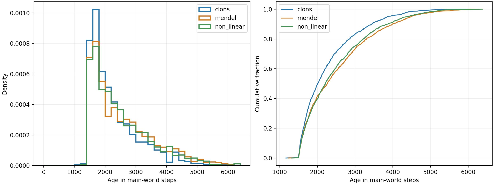
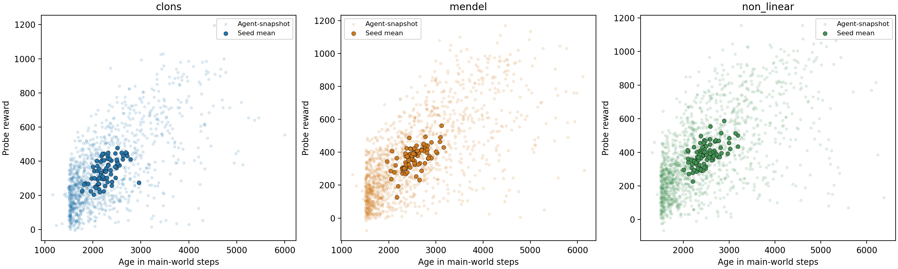
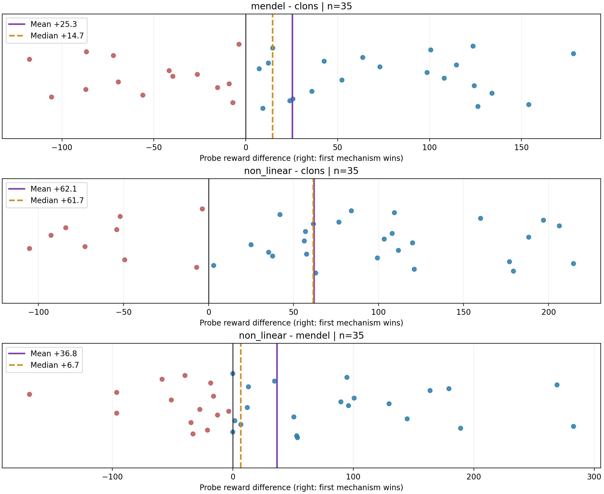
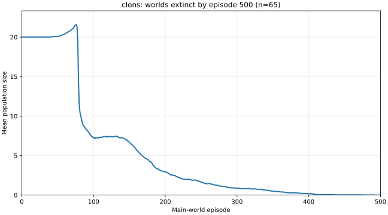
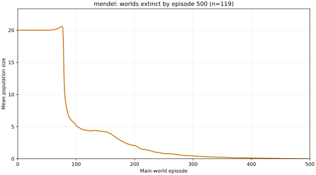
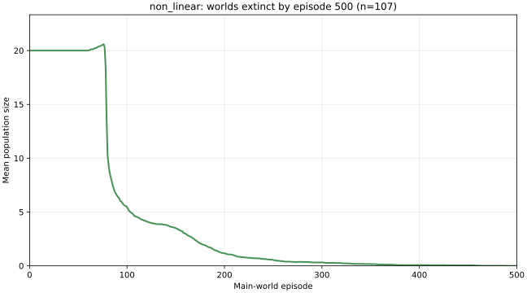

# Pairwise overlap
## 1. Probe: comparison only up to 2000 episodes

Each pair uses all shared seeds for which both worlds survived to 2000 episodes and have probe measurements. Survival of the third mechanism is not required. Batches without probes are excluded. Even when the main run continued to 3000 or 5000 episodes, only snapshots no later than step 40000 are used (2000 episodes × 20 steps).

World metric: in each of the last three available probe snapshots before this limit, env_reward is summed over the isolated run of each selected agent, then averaged across agents and across the three snapshots. This is total external reward in the probe, not the reward of the main population. The difference is always the first mechanism minus the second.

Statistics are calculated from paired differences dᵢ: SD is the sample standard deviation, SEM=SD/√n, MoE(95%)=t₀.₉₇₅,ₙ₋₁×SEM, CI=mean(dᵢ)±MoE. Calculations use unrounded values; tables show three decimal places.

### 1.1. mendel - clones

**All matching seeds: n=46 (92 worlds).**

|seed|Batch|mendel|clones|mendel - clones|
|---|---|---:|---:|---:|
|64713326|batch2-30|308.667|299.333|+9.333|
|72061729|batch5-third30|333.667|300.667|+33.000|
|119331123|batch2-30|423.667|297.333|+126.333|
|129324135|batch2-30|378.333|224.333|+154.000|
|139961480|batch5-third30|397.000|404.000|-7.000|
|278906185|batch3-extra15|423.333|399.333|+24.000|
|357697139|batch5-third30|365.000|339.333|+25.667|
|424772428|batch4-extra10|304.333|410.000|-105.667|
|465619781|batch5-third30|375.667|431.667|-56.000|
|510294881|batch3-extra15|338.667|204.667|+134.000|
|588057067|batch1|279.667|360.667|-81.000|
|611563536|batch4-extra10|410.000|374.000|+36.000|
|675705288|batch2-30|324.000|411.000|-87.000|
|703876974|batch1|326.000|442.667|-116.667|
|914445736|batch1|352.333|367.667|-15.333|
|999047946|batch2-30|561.333|413.000|+148.333|
|1094375482|batch3-extra15|353.000|444.667|-91.667|
|1111184216|batch4-extra10|387.000|262.667|+124.333|
|1126652752|batch5-third30|490.667|275.000|+215.667|
|1190988665|batch2-30|421.333|430.333|-9.000|
|1226380944|batch1|376.667|446.000|-69.333|
|1313357300|batch5-third30|323.333|271.000|+52.333|
|1344494084|batch5-third30|387.000|279.000|+108.000|
|1369528673|batch5-third30|304.000|343.667|-39.667|
|1466525455|batch5-third30|270.667|297.000|-26.333|
|1479639638|batch2-30|326.000|330.000|-4.000|
|1482009083|batch2-30|378.333|279.667|+98.667|
|1541155865|batch3-extra15|407.667|449.333|-41.667|
|1551805766|batch2-30|307.667|300.333|+7.333|
|1603734309|batch3-extra15|487.333|414.333|+73.000|
|1616709634|batch5-third30|460.000|345.333|+114.667|
|1633811275|batch2-30|463.333|451.000|+12.333|
|1634495950|batch2-30|299.667|224.333|+75.333|
|1656982212|batch5-third30|267.667|225.000|+42.667|
|1672802596|batch4-extra10|285.333|403.000|-117.667|
|1706578473|batch2-30|328.333|264.667|+63.667|
|1769747038|batch5-third30|231.000|303.000|-72.000|
|1875769966|batch3-extra15|394.667|258.000|+136.667|
|1891633362|batch2-30|414.333|236.000|+178.333|
|2003317259|batch3-extra15|253.333|340.000|-86.667|
|2045177547|batch3-extra15|362.000|431.000|-69.000|
|2135414605|batch2-30|450.333|349.667|+100.667|
|2151682457|batch1|362.333|347.667|+14.667|
|2482739106|batch1|393.000|269.333|+123.667|
|4232660768|batch1|298.000|301.667|-3.667|
|4253778242|batch1|443.667|255.000|+188.667|
|**Mean**|**46 seeds**|**365.855**|**337.116**|**+28.739**|

|Metric|Value|
|-------------------|----------------:|
|n, shared seeds|46|
|Mean difference d̄|+28.739|
|SD|89.983|
|SEM|13.267|
|MoE (95%)|±26.722|
|95% CI|[+2.018; +55.461]|
|Difference > 0|27/46 (58.7%)|
|Difference > 30|21/46 (45.7%)|
|Difference > 60|17/46 (37.0%)|

### 1.2. non_linear - clones

**All matching seeds: n=58 (116 worlds).**

|seed|Batch|non_linear|clones|non_linear - clones|
|-----------|--------------|----------:|----------:|-----------------:|
|40248644|batch3-extra15|369.333|376.667|-7.333|
|64713326|batch2-30|362.333|299.333|+63.000|
|119331123|batch2-30|476.667|297.333|+179.333|
|129324135|batch2-30|345.333|224.333|+121.000|
|139961480|batch5-third30|397.000|404.000|-7.000|
|248674815|batch5-third30|406.667|360.667|+46.000|
|278906185|batch3-extra15|402.333|399.333|+3.000|
|357697139|batch5-third30|554.000|339.333|+214.667|
|424772428|batch4-extra10|587.000|410.000|+177.000|
|465619781|batch5-third30|382.333|431.667|-49.333|
|510294881|batch3-extra15|304.000|204.667|+99.333|
|554097749|batch5-third30|386.000|324.333|+61.667|
|611563536|batch4-extra10|411.667|374.000|+37.667|
|650643595|batch5-third30|331.000|372.000|-41.000|
|670202583|batch2-30|277.333|218.000|+59.333|
|675705288|batch2-30|468.667|411.000|+57.667|
|701897230|batch2-30|392.667|312.333|+80.333|
|707728676|batch5-third30|372.000|387.667|-15.667|
|863076076|batch2-30|413.333|450.667|-37.333|
|914445736|batch1|403.000|367.667|+35.333|
|1033668013|batch3-extra15|485.000|478.333|+6.667|
|1036090771|batch2-30|410.333|404.000|+6.333|
|1040176728|batch2-30|309.000|447.000|-138.000|
|1107032872|batch4-extra10|455.333|412.000|+43.333|
|1111184216|batch4-extra10|374.333|262.667|+111.667|
|1190988665|batch2-30|325.000|430.333|-105.333|
|1226380944|batch1|373.333|446.000|-72.667|
|1278549092|batch3-extra15|457.000|267.000|+190.000|
|1290435116|batch1|359.333|397.667|-38.333|
|1310630172|batch4-extra10|307.000|343.667|-36.667|
|1313357300|batch5-third30|296.000|271.000|+25.000|
|1327050699|batch5-third30|377.000|294.333|+82.667|
|1344494084|batch5-third30|399.000|279.000|+120.000|
|1369528673|batch5-third30|400.000|343.667|+56.333|
|1466525455|batch5-third30|400.333|297.000|+103.333|
|1482009083|batch2-30|468.000|279.667|+188.333|
|1520125360|batch5-third30|437.333|267.000|+170.333|
|1537488854|batch2-30|435.000|316.667|+118.333|
|1541155865|batch3-extra15|356.667|449.333|-92.667|
|1551805766|batch2-30|408.333|300.333|+108.000|
|1603734309|batch3-extra15|471.333|414.333|+57.000|
|1616709634|batch5-third30|291.333|345.333|-54.000|
|1633811275|batch2-30|367.000|451.000|-84.000|
|1656982212|batch5-third30|431.333|225.000|+206.333|
|1672802596|batch4-extra10|464.667|403.000|+61.667|
|1706578473|batch2-30|341.333|264.667|+76.667|
|1708432993|batch2-30|405.333|373.667|+31.667|
|1769747038|batch5-third30|500.000|303.000|+197.000|
|1842464693|batch4-extra10|513.000|249.667|+263.333|
|1891633362|batch2-30|396.000|236.000|+160.000|
|1974994958|batch4-extra10|356.333|245.667|+110.667|
|2003317259|batch3-extra15|288.000|340.000|-52.000|
|2011396667|batch2-30|468.667|380.333|+88.333|
|2135414605|batch2-30|391.667|349.667|+42.000|
|2151682457|batch1|457.000|347.667|+109.333|
|2482739106|batch1|353.333|269.333|+84.000|
|2974571302|batch1|305.333|406.000|-100.667|
|4232660768|batch1|298.000|301.667|-3.667|
|**Mean**|**58 seeds**|**396.132**|**342.374**|**+53.759**|

|Metric|Value|
|-------------------|-----------------:|
|n, shared seeds|58|
|Mean difference d̄|+53.759|
|SD|91.316|
|SEM|11.990|
|MoE (95%)|±24.010|
|95% CI|[+29.748; +77.769]|
|Difference > 0|41/58 (70.7%)|
|Difference > 30|37/58 (63.8%)|
|Difference > 60|27/58 (46.6%)|

### 1.3. non_linear - mendel

**All matching seeds: n=59 (118 worlds).**

|seed|Batch|non_linear|mendel|non_linear - mendel|
|---|---|---:|---:|---:|
|1872227|batch7-mn|355.667|441.333|-85.667|
|64713326|batch2-30|362.333|308.667|+53.667|
|119331123|batch2-30|476.667|423.667|+53.000|
|129324135|batch2-30|345.333|378.333|-33.000|
|139961480|batch5-third30|397.000|397.000|+0.000|
|239209567|batch7-mn|514.000|413.000|+101.000|
|278906185|batch3-extra15|402.333|423.333|-21.000|
|301112939|batch1|477.333|494.333|-17.000|
|357697139|batch5-third30|554.000|365.000|+189.000|
|393842989|batch5-third30|411.667|379.333|+32.333|
|403430828|batch7-mn|286.000|126.667|+159.333|
|424772428|batch4-extra10|587.000|304.333|+282.667|
|465619781|batch5-third30|382.333|375.667|+6.667|
|510294881|batch3-extra15|304.000|338.667|-34.667|
|581462584|batch5-third30|226.333|315.000|-88.667|
|589223109|batch7-mn|471.667|304.667|+167.000|
|601965122|batch7-mn|312.333|396.667|-84.333|
|611563536|batch4-extra10|411.667|410.000|+1.667|
|675705288|batch2-30|468.667|324.000|+144.667|
|702776801|batch7-mn|431.667|444.333|-12.667|
|822752837|batch7-mn|496.667|302.333|+194.333|
|828443656|batch2-30|370.667|392.000|-21.333|
|914445736|batch1|403.000|352.333|+50.667|
|1096401903|batch7-mn|382.667|237.333|+145.333|
|1104895240|batch7-mn|330.333|333.000|-2.667|
|1111184216|batch4-extra10|374.333|387.000|-12.667|
|1145503755|batch7-mn|434.667|362.333|+72.333|
|1190988665|batch2-30|325.000|421.333|-96.333|
|1205743217|batch7-mn|316.000|302.667|+13.333|
|1226380944|batch1|373.333|376.667|-3.333|
|1313357300|batch5-third30|296.000|323.333|-27.333|
|1344494084|batch5-third30|399.000|387.000|+12.000|
|1369528673|batch5-third30|400.000|304.000|+96.000|
|1392554070|batch7-mn|302.667|345.333|-42.667|
|1466525455|batch5-third30|400.333|270.667|+129.667|
|1482009083|batch2-30|468.000|378.333|+89.667|
|1541155865|batch3-extra15|356.667|407.667|-51.000|
|1551805766|batch2-30|408.333|307.667|+100.667|
|1553714382|batch7-mn|379.333|289.667|+89.667|
|1587353058|batch4-extra10|352.333|278.667|+73.667|
|1603734309|batch3-extra15|471.333|487.333|-16.000|
|1616709634|batch5-third30|291.333|460.000|-168.667|
|1633811275|batch2-30|367.000|463.333|-96.333|
|1656982212|batch5-third30|431.333|267.667|+163.667|
|1672802596|batch4-extra10|464.667|285.333|+179.333|
|1706578473|batch2-30|341.333|328.333|+13.000|
|1752463988|batch7-mn|390.000|376.000|+14.000|
|1769747038|batch5-third30|500.000|231.000|+269.000|
|1791642866|batch2-30|365.333|431.333|-66.000|
|1858319785|batch2-30|329.667|397.000|-67.333|
|1875054694|batch3-extra15|291.333|364.000|-72.667|
|1885837680|batch7-mn|271.667|193.333|+78.333|
|1891633362|batch2-30|396.000|414.333|-18.333|
|2003317259|batch3-extra15|288.000|253.333|+34.667|
|2125720082|batch7-mn|415.333|393.000|+22.333|
|2135414605|batch2-30|391.667|450.333|-58.667|
|2151682457|batch1|457.000|362.333|+94.667|
|2482739106|batch1|353.333|393.000|-39.667|
|4232660768|batch1|298.000|298.000|+0.000|
|**Mean**|**59 seeds**|**387.486**|**355.463**|**+32.023**|

|Metric|Value|
|-------------------|----------------:|
|n, shared seeds|59|
|Mean difference d̄|+32.023|
|SD|94.462|
|SEM|12.298|
|MoE (95%)|±24.617|
|95% CI|[+7.406; +56.640]|
|Difference > 0|32/59 (54.2%)|
|Difference > 30|25/59 (42.4%)|
|Difference > 60|20/59 (33.9%)|

## 2. Survival up to 500 episodes

A common horizon for all batches: main-simulation population > 0 at step 10000 (500 episodes × 20 steps). A world that became extinct earlier is counted as not surviving. For long runs, the state at exactly step 10000 is used; their final population at episodes 2000/3000/5000 is not used here. Thus different run durations are not mixed in this section.

|Mechanism|Survived|Total worlds|Survival|
|----------|-----:|----------:|-----------:|
|clones|235|300|78.333%|
|mendel|231|350|66.000%|
|non_linear|243|350|69.429%|

### Pairwise survival differences

Only the shared seeds of each pair are used. Comparisons with clones have 300, since the additional 50 seeds in batch 7 were run only for mendel and non_linear. The overall percentages in the previous table refer to all worlds of each mechanism, so subtracting them directly may give a different result from the paired differences below.

Paired estimate: dᵢ=I(first mechanism survived)-I(second mechanism survived), SEM=SD(dᵢ)/√n, MoE=1.959964×SEM, 95% CI=d̄±MoE. Differences and margins of error are expressed in percentage points (pp).

|Pair: first - second|Shared seeds|Survived: first|Survived: second|Difference, pp|SEM, pp|MoE (95%), pp|95% CI, pp|
|---------------------|----------:|----------------:|----------------:|-----------:|------:|------------:|-----------------|
|clones - mendel|300|235/300 (78.333%)|206/300 (68.667%)|+9.667|3.780|±7.410|[+2.257; +17.076]|
|clones - non_linear|300|235/300 (78.333%)|214/300 (71.333%)|+7.000|3.124|±6.123|[+0.877; +13.123]|
|non_linear - mendel|350|243/350 (69.429%)|231/350 (66.000%)|+3.429|3.429|±6.720|[-3.291; +10.148]|

## Notes

All 95% intervals are ordinary pointwise intervals, without correction for multiple comparisons or sequential examination of results. Probe estimates concern worlds that survived to 2000 episodes under both mechanisms in a pair; extinct worlds are included in the survival section but are not assigned zero probe reward.

# Age and probe reward

Main sample: all available probe worlds for each mechanism that survived to 2000 episodes; the last three snapshots ≤40000 steps. This is a broader sample than the intersection of all three mechanisms. Age is taken from the main world by agent_id and snapshot step, in lifetime steps; age from the isolated probe is not used.

One agent may appear in several snapshots. Individual agent-snapshots are therefore not treated as independent replicates; their correlations are descriptive only. For the main estimate of association, each seed is represented by one point: the mean age of the selected agents and mean probe reward across three snapshots. The correlation interval was obtained by bootstrap resampling of whole seeds (2000 repetitions, fixed RNG).

|Mechanism|Worlds|Agent-snapshots|Age Q25|Median|Q75|Mean age|
|----------|----:|------------:|----------:|------:|-----:|--------------:|
|clones|76|1140|1676.8|2007.5|2645.0|2273.0|
|mendel|89|1335|1729.5|2263.0|3048.5|2531.8|
|non_linear|96|1440|1736.0|2213.0|2975.5|2483.3|

## Association between age and reward

|Mechanism|Pearson, agent-snapshots|Spearman, agent-snapshots|Pearson, seed means|Bootstrap 95% CI Pearson|Spearman, seed means|
|----------|--------------------:|---------------------:|---------------------:|------------------------|----------------------:|
|clones|+0.650|+0.607|+0.545|[+0.335; +0.708]|+0.585|
|mendel|+0.677|+0.682|+0.612|[+0.469; +0.738]|+0.619|
|non_linear|+0.601|+0.621|+0.586|[+0.461; +0.688]|+0.594|

> Height 0.001 × width 200 steps = 0.2, or about **20% of observations** in this age interval.

# Three mechanisms on the same set of seeds

Shared seeds: **35**. All three worlds survived to 2000 episodes and have three probe snapshots no later than step 40000. Each world's metric is the mean across agents within a snapshot, then across the last three snapshots.

|seed|clones|mendel|non_linear|
|---|---:|---:|---:|
|64713326|299.333|308.667|362.333|
|119331123|297.333|423.667|476.667|
|129324135|224.333|378.333|345.333|
|139961480|404.000|397.000|397.000|
|278906185|399.333|423.333|402.333|
|357697139|339.333|365.000|554.000|
|424772428|410.000|304.333|587.000|
|465619781|431.667|375.667|382.333|
|510294881|204.667|338.667|304.000|
|611563536|374.000|410.000|411.667|
|675705288|411.000|324.000|468.667|
|914445736|367.667|352.333|403.000|
|1111184216|262.667|387.000|374.333|
|1190988665|430.333|421.333|325.000|
|1226380944|446.000|376.667|373.333|
|1313357300|271.000|323.333|296.000|
|1344494084|279.000|387.000|399.000|
|1369528673|343.667|304.000|400.000|
|1466525455|297.000|270.667|400.333|
|1482009083|279.667|378.333|468.000|
|1541155865|449.333|407.667|356.667|
|1551805766|300.333|307.667|408.333|
|1603734309|414.333|487.333|471.333|
|1616709634|345.333|460.000|291.333|
|1633811275|451.000|463.333|367.000|
|1656982212|225.000|267.667|431.333|
|1672802596|403.000|285.333|464.667|
|1706578473|264.667|328.333|341.333|
|1769747038|303.000|231.000|500.000|
|1891633362|236.000|414.333|396.000|
|2003317259|340.000|253.333|288.000|
|2135414605|349.667|450.333|391.667|
|2151682457|347.667|362.333|457.000|
|2482739106|269.333|393.000|353.333|
|4232660768|301.667|298.000|298.000|

## mendel - clones

|Metric|Value|
|------------------------|----------------:|
|n|35|
|Mean|+25.333|
|Median|+14.667|
|SD|79.887|
|SEM|13.503|
|MoE 95%|±27.442|
|95% CI|[-2.109; +52.776]|
|Difference > 0 / < 0 / = 0|21 / 14 / 0|

## non_linear - clones

|Metric|Value|
|---|---:|
|n|35|
|Mean|+62.114|
|Median|+61.667|
|SD|90.475|
|SEM|15.293|
|MoE 95%|±31.079|
|95% CI|[+31.035; +93.193]|
|Difference > 0 / < 0 / = 0|26 / 9 / 0|

## non_linear - mendel

|Metric|Value|
|------------------------|----------------:|
|n|35|
|Mean|+36.781|
|Median|+6.667|
|SD|100.346|
|SEM|16.962|
|MoE 95%|±34.470|
|95% CI|[+2.311; +71.251]|
|Difference > 0 / < 0 / = 0|19 / 14 / 2|

  Each point is one reward difference. For example, in the non_linear - mendel panel:

- **To the right of zero:** the first mechanism has higher reward.
- **To the left:** the second has higher reward.
- **At zero:** equal reward.
- The solid purple line is the **mean difference**.
- The dashed orange line is the **median difference**.

# Recovery after a population decline

The original cohort contains 1000 worlds. The denominator of each row below is not extinct worlds as such, but all worlds whose population fell below the specified threshold by ep500, including those that eventually became extinct. This is not an "extinct only" sample; a comparison with that sample is given at the end of the section. Each world is counted once. Recovery after a decline is counted even if the world later became extinct again. These are observed proportions; the significance of the differences has not yet been tested.

After population fell **below 10** and subsequently reached **≥70 before episode 500** (the denominator is all worlds that experienced such a decline):

|Mechanism|Recovered / experienced decline|Proportion|
|----------|---------------------------------|----------|
|clones|75 / 153|**49.02%**|
|mendel|96 / 222|**43.24%**|
|non_linear|115 / 226|**50.88%**|

With a **population <15** threshold, recovery to **≥70**, and a **500-episode** limit:

|Mechanism|Recovered / experienced decline|Proportion|
|---|---|---|
|clones|154 / 233|**66.09%**|
|mendel|175 / 301|**58.14%**|
|non_linear|178 / 289|**61.59%**|

After population fell **below 5** and then reached **≥70 before episode 500**:

|Mechanism|Recovered / experienced decline|Proportion|
|---|---|---|
|clones|12 / 88|**13.64%**|
|mendel|16 / 141|**11.35%**|
|non_linear|28 / 139|**20.14%**|

**For comparison, the sample of worlds that actually became extinct by ep500 only** (65 / 119 / 107 clones / mendel / non_linear worlds, 291 in total; the same worlds as in the "Founder learning rate" section below): recovery from <10 to ≥70 among them was 0/65, 0/119, 0/107, or 0/291 in total. This does not replace the three tables above: their denominator is all worlds that fell below the threshold (including those that later survived), whereas here it is only worlds that actually became extinct by ep500. None of these actually extinct worlds recovered after such a deep decline.

# Founder learning rate: detailed distributions

All 1000 worlds, 20 000 founders. The outcome is extinction before 500 episodes; survivors are worlds still alive at that point. Only the learning rate of the initial agents is analyzed, with no descendants. The main variable is the initial learning-rate phenotype: the expressed value actually used by the agent. For mendel this is not the mean of the two alleles; the original alleles are saved separately in CSV.

The config reference value is 0.001. A value below it does not mean a malfunction. The boundaries below are descriptive ranges, not identified thresholds of a causal effect. Agent percentages describe the composition of founders; the statistical unit remains the world. There are no additional significance tests here.

## clones

Extinct: 65 worlds / 1300 founders. Survived: 235 worlds / 4700 founders.

### Distribution across individual founders

|Group|Mean|Q25|Median|Q75|Minimum|Maximum|
|--------|--------:|--------:|--------:|--------:|--------:|--------:|
|Extinct|0.0009782|0.0006113|0.0009806|0.0013218|0.0000002|0.0024789|
|Survived|0.0010285|0.0006841|0.0010228|0.0013541|0.0000006|0.0027856|

|Agent learning rate|Among founders of extinct worlds|Among founders of surviving worlds|
|--------------------|-------------------------:|-------------------------:|
|<0.0005|228/1300 (17.5%)|713/4700 (15.2%)|
|0.0005-<0.0008|259/1300 (19.9%)|821/4700 (17.5%)|
|0.0008-<0.001|184/1300 (14.2%)|726/4700 (15.4%)|
|0.001-<0.0012|188/1300 (14.5%)|758/4700 (16.1%)|
|0.0012-<0.0015|250/1300 (19.2%)|898/4700 (19.1%)|
|≥0.0015|191/1300 (14.7%)|784/4700 (16.7%)|

### How many founders with lower LR are in one world

Lower here means strictly <0.001.

|Founders with LR<0.001 out of 20|Extinct worlds|Surviving worlds|Extinction proportion among worlds in this row|
|----------------------------|-------------:|-------------:|------------------------------------:|
|0|0 (0.0%)|0 (0.0%)|0/0 (-)|
|1-4|0 (0.0%)|5 (2.1%)|0/5 (0.0%)|
|5-9|20 (30.8%)|107 (45.5%)|20/127 (15.7%)|
|10-14|45 (69.2%)|120 (51.1%)|45/165 (27.3%)|
|15-19|0 (0.0%)|3 (1.3%)|0/3 (0.0%)|
|20|0 (0.0%)|0 (0.0%)|0/0 (-)|

### Frequency of a similar deviation and a large reduction

|World condition|Among extinct worlds|Among surviving worlds|
|---|---:|---:|
|Mean LR of 20 founders <0.001|38/65 (58.5%)|96/235 (40.9%)|
|Mean LR ≤0.000978 (near the observed mendel mean in extinct worlds)|32/65 (49.2%)|74/235 (31.5%)|
|At least one founder with LR<0.0005|65/65 (100.0%)|231/235 (98.3%)|
|At least 5 founders with LR<0.0005|16/65 (24.6%)|37/235 (15.7%)|

The 0.000978 threshold was selected after the previous analysis; its table is descriptive and is not independent confirmation.

### Extinction by mean founder LR

|World mean LR|Extinct|Survived|Total|Extinction proportion|
|---|---:|---:|---:|---:|
|<0.00090|14|31|45|31.1%|
|0.00090-<0.00095|10|25|35|28.6%|
|0.00095-<0.00100|14|40|54|25.9%|
|0.00100-<0.00105|10|40|50|20.0%|
|0.00105-<0.00110|10|34|44|22.7%|
|≥0.00110|7|65|72|9.7%|

### Quartiles of the distribution of world mean LR

Quartile boundaries were calculated separately for each mechanism using all its worlds, regardless of outcome.

|Quartile|Mean LR range|Extinct / total|Extinction proportion|
|---|---|---:|---:|
|Q1|[-inf; 0.0009378)|23/75|30.7%|
|Q2|[0.0009378; 0.0010168)|19/75|25.3%|
|Q3|[0.0010168; 0.0010916)|15/75|20.0%|
|Q4|[0.0010916; inf)|8/75|10.7%|

## mendel

Extinct: 119 worlds / 2380 founders. Survived: 231 worlds / 4620 founders.

### Distribution across individual founders

|Group|Mean|Q25|Median|Q75|Minimum|Maximum|
|---|---:|---:|---:|---:|---:|---:|
|Extinct|0.0009779|0.0006430|0.0009679|0.0013018|0.0000021|0.0025694|
|Survived|0.0010338|0.0006903|0.0010213|0.0013632|0.0000013|0.0027759|

|Agent learning rate|Among founders of extinct worlds|Among founders of surviving worlds|
|--------------------|-------------------------:|-------------------------:|
|<0.0005|396/2380 (16.6%)|672/4620 (14.5%)|
|0.0005-<0.0008|491/2380 (20.6%)|827/4620 (17.9%)|
|0.0008-<0.001|355/2380 (14.9%)|723/4620 (15.6%)|
|0.001-<0.0012|360/2380 (15.1%)|748/4620 (16.2%)|
|0.0012-<0.0015|438/2380 (18.4%)|849/4620 (18.4%)|
|≥0.0015|340/2380 (14.3%)|801/4620 (17.3%)|

### How many founders with lower LR are in one world

Lower here means strictly <0.001.

|Founders with LR<0.001 out of 20|Extinct worlds|Surviving worlds|Extinction proportion among worlds in this row|
|----------------------------|-------------:|-------------:|------------------------------------:|
|0|0 (0.0%)|0 (0.0%)|0/0 (-)|
|1-4|0 (0.0%)|3 (1.3%)|0/3 (0.0%)|
|5-9|40 (33.6%)|105 (45.5%)|40/145 (27.6%)|
|10-14|75 (63.0%)|122 (52.8%)|75/197 (38.1%)|
|15-19|4 (3.4%)|1 (0.4%)|4/5 (80.0%)|
|20|0 (0.0%)|0 (0.0%)|0/0 (-)|

### Frequency of a similar deviation and a large reduction

|World condition|Among extinct worlds|Among surviving worlds|
|------------------------------------------------------------------|--------------:|--------------:|
|Mean LR of 20 founders <0.001|67/119 (56.3%)|82/231 (35.5%)|
|Mean LR ≤0.000978 (near the observed mendel mean in extinct worlds)|53/119 (44.5%)|65/231 (28.1%)|
|At least one founder with LR<0.0005|117/119 (98.3%)|222/231 (96.1%)|
|At least 5 founders with LR<0.0005|24/119 (20.2%)|34/231 (14.7%)|

The 0.000978 threshold was selected after the previous analysis; its table is descriptive and is not independent confirmation.

### Extinction by mean founder LR

|World mean LR|Extinct|Survived|Total|Extinction proportion|
|---|---:|---:|---:|---:|
|<0.00090|31|22|53|58.5%|
|0.00090-<0.00095|11|21|32|34.4%|
|0.00095-<0.00100|25|39|64|39.1%|
|0.00100-<0.00105|26|45|71|36.6%|
|0.00105-<0.00110|12|48|60|20.0%|
|≥0.00110|14|56|70|20.0%|

### Quartiles of the distribution of world mean LR

Quartile boundaries were calculated separately for each mechanism using all its worlds, regardless of outcome.

|Quartile|Mean LR range|Extinct / total|Extinction proportion|
|---|---|---:|---:|
|Q1|[-inf; 0.0009550)|43/88|48.9%|
|Q2|[0.0009550; 0.0010241)|36/87|41.4%|
|Q3|[0.0010241; 0.0010846)|21/87|24.1%|
|Q4|[0.0010846; inf)|19/88|21.6%|

## non_linear

Extinct: 107 worlds / 2140 founders. Survived: 243 worlds / 4860 founders.

### Distribution across individual founders

|Group|Mean|Q25|Median|Q75|Minimum|Maximum|
|---|---:|---:|---:|---:|---:|---:|
|Extinct|0.0010044|0.0006504|0.0009980|0.0013315|0.0000002|0.0026429|
|Survived|0.0010243|0.0006740|0.0010192|0.0013557|0.0000006|0.0027856|

|Agent learning rate|Among founders of extinct worlds|Among founders of surviving worlds|
|---|---:|---:|
|<0.0005|346/2140 (16.2%)|759/4860 (15.6%)|
|0.0005-<0.0008|397/2140 (18.6%)|857/4860 (17.6%)|
|0.0008-<0.001|331/2140 (15.5%)|726/4860 (14.9%)|
|0.001-<0.0012|325/2140 (15.2%)|782/4860 (16.1%)|
|0.0012-<0.0015|393/2140 (18.4%)|921/4860 (19.0%)|
|≥0.0015|348/2140 (16.3%)|815/4860 (16.8%)|

### How many founders with lower LR are in one world

Lower here means strictly <0.001.

|Founders with LR<0.001 out of 20|Extinct worlds|Surviving worlds|Extinction proportion among worlds in this row|
|---|---:|---:|---:|
|0|0 (0.0%)|0 (0.0%)|0/0 (-)|
|1-4|1 (0.9%)|5 (2.1%)|1/6 (16.7%)|
|5-9|47 (43.9%)|102 (42.0%)|47/149 (31.5%)|
|10-14|57 (53.3%)|134 (55.1%)|57/191 (29.8%)|
|15-19|2 (1.9%)|2 (0.8%)|2/4 (50.0%)|
|20|0 (0.0%)|0 (0.0%)|0/0 (-)|

### Frequency of a similar deviation and a large reduction

|World condition|Among extinct worlds|Among surviving worlds|
|---|---:|---:|
|Mean LR of 20 founders <0.001|52/107 (48.6%)|105/243 (43.2%)|
|Mean LR ≤0.000978 (near the observed mendel mean in extinct worlds)|43/107 (40.2%)|82/243 (33.7%)|
|At least one founder with LR<0.0005|106/107 (99.1%)|239/243 (98.4%)|
|At least 5 founders with LR<0.0005|22/107 (20.6%)|43/243 (17.7%)|

The 0.000978 threshold was selected after the previous analysis; its table is descriptive and is not independent confirmation.

### Extinction by mean founder LR

|World mean LR|Extinct|Survived|Total|Extinction proportion|
|---|---:|---:|---:|---:|
|<0.00090|20|31|51|39.2%|
|0.00090-<0.00095|13|30|43|30.2%|
|0.00095-<0.00100|19|44|63|30.2%|
|0.00100-<0.00105|20|37|57|35.1%|
|0.00105-<0.00110|14|38|52|26.9%|
|≥0.00110|21|63|84|25.0%|

### Quartiles of the distribution of world mean LR

Quartile boundaries were calculated separately for each mechanism using all its worlds, regardless of outcome.

|Quartile|Mean LR range|Extinct / total|Extinction proportion|
|---|---|---:|---:|
|Q1|[-inf; 0.0009386)|31/88|35.2%|
|Q2|[0.0009386; 0.0010161)|29/87|33.3%|
|Q3|[0.0010161; 0.0010906)|25/87|28.7%|
|Q4|[0.0010906; inf)|22/88|25.0%|

# Genes: initial settings and founder variation

Settings come from run.json for the bad-baseline experiments with evolution that were actually run. Agreement of gene parameters and the evolution list was checked across all 1000 worlds. The actual distributions below were calculated from 20 000 founders (births at step 0), including founders of extinct worlds. Descendants and changes in genes during an agent's lifetime are not included here.

## Initial settings

|Gene|Purpose|Phenotype type|Center μ|Config spread σ|Varies / evolves|
|---|---|---|---:|---:|---|
|`alpha`|Parental blending range in non_linear|float|0.5|0.5|No: fixed at μ|
|`sigma`|Gene mutation probability|float|0.05|0.001|No: fixed at μ|
|`learning_rate`|Adam learning rate|float|0.001|0.0005|Yes|
|`max_norm`|Gradient norm clipping threshold|float|0.01|0.005|Yes|
|`gamma`|Future reward discounting|float|0.5|0.2|Yes|
|`target_update_freq`|Target network update interval|int|200|40|Yes|
|`hidden_size`|Neurons per hidden layer|int|40|8|Yes|
|`hidden_layers`|Number of hidden layers|int|2|0.5|Yes|
|`buffer_size`|Replay buffer capacity|int|1000|2000|Yes|
|`batch_size`|Training batch size|int|32|4|Yes|
|`min_buffer_size`|Buffer threshold for starting training|int|500|100|No: fixed at μ|
|`epsilon`|Initial random-action probability|float|0.5|0.1|Yes|
|`epsilon_decay`|Epsilon decay multiplier|float|0.98|0.002|Yes|
|`epsilon_min`|Epsilon lower bound|float|0.05|0.005|Yes|
|`curiosity_beta`|Initial curiosity weight|float|1|0.5|Yes|
|`curiosity_decay`|Curiosity decay multiplier|float|0.995|0.002|Yes|

**What σ means:** the standard deviation of the normal distribution used to generate the initial genotype, not hard range boundaries or mutation magnitude. The constraints specified in the code and conversion to phenotype are applied afterward. Actual SDs and ranges below may therefore differ from σ.

**Frozen genes:** alpha, sigma, and min_buffer_size. Their scale is listed in the config, but when evolution for that gene is disabled, the random result is not used; the value is set to μ.

**Integer genes:** rounding and constraints are applied when forming the phenotype; an individual agent has an integer value. A fractional mean across many agents in the table does not mean that an agent has a fractional number of layers. In mendel each gene has two alleles; the tables below count exactly one recorded expressed phenotype per founder, not the mean of the alleles.

## Actual founder phenotypes: clones

300 worlds, 6000 founders. SD is the sample standard deviation across all founders of this mechanism, not the SD of world means. All values before display rounding come from phen_* in the main birth log.

|Gene|Mean|SD|Q25|Median|Q75|Minimum|Maximum|
|---|---:|---:|---:|---:|---:|---:|---:|
|`alpha`|0.5|0|0.5|0.5|0.5|0.5|0.5|
|`sigma`|0.05|0|0.05|0.05|0.05|0.05|0.05|
|`learning_rate`|0.00101763|0.000489023|0.000669361|0.00101354|0.00134606|2.12216e-07|0.00278564|
|`max_norm`|0.0101123|0.00494827|0.00665517|0.00997467|0.0134147|2.27736e-06|0.0307787|
|`gamma`|0.502771|0.19706|0.369488|0.504383|0.63802|0.001|0.999037|
|`target_update_freq`|199.771|40.0551|173|199|227|60|332|
|`hidden_size`|40.0358|8.00468|35|40|46|11|70|
|`hidden_layers`|2.00083|0.578983|2|2|2|0|4|
|`buffer_size`|1561.68|1326.32|500|992|2347.5|500|7618|
|`batch_size`|32.0687|4.04306|29|32|35|19|48|
|`min_buffer_size`|500|0|500|500|500|500|500|
|`epsilon`|0.500028|0.101011|0.433456|0.499195|0.566261|0.118322|0.938259|
|`epsilon_decay`|0.980014|0.00200582|0.978638|0.980008|0.981399|0.97222|0.98718|
|`epsilon_min`|0.050115|0.00501829|0.0468144|0.0501495|0.0534085|0.0325052|0.0691145|
|`curiosity_beta`|1.00024|0.502325|0.657528|0.997274|1.34228|-0.753994|2.66888|
|`curiosity_decay`|0.995044|0.0019639|0.993733|0.995018|0.996373|0.987951|0.999994|

## Actual founder phenotypes: mendel

350 worlds, 7000 founders. SD is the sample standard deviation across all founders of this mechanism, not the SD of world means. All values before display rounding come from phen_* in the main birth log.

|Gene|Mean|SD|Q25|Median|Q75|Minimum|Maximum|
|---|---:|---:|---:|---:|---:|---:|---:|
|`alpha`|0.5|0|0.5|0.5|0.5|0.5|0.5|
|`sigma`|0.05|0|0.05|0.05|0.05|0.05|0.05|
|`learning_rate`|0.00101477|0.000491961|0.000670543|0.00100476|0.00134232|1.2921e-06|0.00277593|
|`max_norm`|0.010125|0.00485934|0.00669627|0.0100871|0.0134114|2.36972e-06|0.026239|
|`gamma`|0.497838|0.198851|0.361441|0.498534|0.634|0.000276256|0.999|
|`target_update_freq`|200.165|40.2997|173|200|227|60|339|
|`hidden_size`|40.0111|8.10509|35|40|46|10|73|
|`hidden_layers`|1.99557|0.576343|2|2|2|0|4|
|`buffer_size`|1565.49|1320.56|500|1016|2332|500|10230|
|`batch_size`|32.0541|3.9741|29|32|35|17|46|
|`min_buffer_size`|500|0|500|500|500|500|500|
|`epsilon`|0.500641|0.0994436|0.434512|0.501825|0.567033|0.14548|0.874446|
|`epsilon_decay`|0.980019|0.00200426|0.978667|0.980002|0.981385|0.972891|0.987309|
|`epsilon_min`|0.0500702|0.00496387|0.0466963|0.0500826|0.053358|0.0324457|0.0700651|
|`curiosity_beta`|0.983894|0.498657|0.64668|0.980119|1.31392|-0.916554|3.07456|
|`curiosity_decay`|0.995|0.00196973|0.993642|0.995008|0.996351|0.988002|0.999998|

## Actual founder phenotypes: non_linear

350 worlds, 7000 founders. SD is the sample standard deviation across all founders of this mechanism, not the SD of world means. All values before display rounding come from phen_* in the main birth log.

|Gene|Mean|SD|Q25|Median|Q75|Minimum|Maximum|
|---|---:|---:|---:|---:|---:|---:|---:|
|`alpha`|0.5|0|0.5|0.5|0.5|0.5|0.5|
|`sigma`|0.05|0|0.05|0.05|0.05|0.05|0.05|
|`learning_rate`|0.00101821|0.000491431|0.000668879|0.00101354|0.00135|2.12216e-07|0.00278564|
|`max_norm`|0.0101078|0.00495339|0.00662924|0.00997467|0.0134149|2.27736e-06|0.0307787|
|`gamma`|0.501814|0.196292|0.368265|0.503124|0.636723|0.001|0.999037|
|`target_update_freq`|199.49|40.2375|172|199|227|60|332|
|`hidden_size`|40.0771|8.00465|35|40|46|11|70|
|`hidden_layers`|1.99457|0.57819|2|2|2|0|4|
|`buffer_size`|1557.6|1326.03|500|982|2346.25|500|7999|
|`batch_size`|32.0756|4.0435|29|32|35|19|48|
|`min_buffer_size`|500|0|500|500|500|500|500|
|`epsilon`|0.500121|0.100567|0.433095|0.499413|0.566805|0.118322|0.938259|
|`epsilon_decay`|0.980001|0.00199773|0.978627|0.979977|0.981364|0.97222|0.987916|
|`epsilon_min`|0.050064|0.00499156|0.0467529|0.0501014|0.0533618|0.0325052|0.0691145|
|`curiosity_beta`|1.00061|0.501329|0.656064|1.00226|1.34137|-0.753994|2.66888|
|`curiosity_decay`|0.995043|0.00197309|0.993708|0.99503|0.996389|0.987536|0.999994|

Q25 and Q75 are the boundaries below which 25% and 75% of observations fall, respectively. The middle 50% of observations lie between them; this is not a confidence interval.

## Separate no-evolution baseline

In the new baseline with 10 seeds × 3 mechanisms, all 16 genes are frozen: genome.evolve=[]. Founder and descendant values are fixed at μ from the first table; there is no random variation in gene values, despite the nonzero scale settings. This baseline is not pooled with the actual distributions of 20 000 founders above.

Note: epsilon and curiosity can decay over the lifetime according to the learning rules; the table describes the initial inherited settings, not their later behavioral values.

# History of seed additions and changes in confidence intervals

Reconstructed from saved experiment worlds and [reproducibility.md](reproducibility%26configs/reproducibility.md) after the folders were merged.

**This is a retrospective recalculation of accumulated data using the same current method throughout.** The rows do not mean that we actually published exactly this CI after each batch.

Stage 5 is split: first, 30 new seeds were run for clones/mendel; then non_linear was added on those same seeds. Batches 2-4 were also ordered ahead of time in a queue; their rows below are reconstructed intermediate snapshots.

## Data additions

|Stage|Addition|Cumulative probe: C/M/N|Cumulative all worlds: C/M/N|
|----|------------------------------------------|----------------------|---------------------------|
|1|First 15 seeds|15 / 15 / 15|15 / 15 / 15|
|2|+30 seeds for all|45 / 45 / 45|45 / 45 / 45|
|3|+15 seeds for all|60 / 60 / 60|60 / 60 / 60|
|4|+10 seeds for all|70 / 70 / 70|70 / 70 / 70|
|5a|+30 seeds: clones and mendel|100 / 100 / 70|100 / 100 / 70|
|5b|Same 30 seeds: non_linear added|100 / 100 / 100|100 / 100 / 100|
|6|+100 seeds for all, survival 500|100 / 100 / 100|200 / 200 / 200|
|7|+50 seeds: mendel and non_linear, probe 2000|100 / 150 / 150|200 / 250 / 250|
|8|+50 seeds for all, survival 500|100 / 150 / 150|250 / 300 / 300|
|9|+50 seeds for all, survival 500|100 / 150 / 150|300 / 350 / 350|

C=clones, M=mendel, N=non_linear. These are counts of main worlds, not individual isolated probe agents. One seed run under three mechanisms produces three main worlds.

## Probe: a 2000-episode horizon

The metric and selection match the [pairwise probe comparisons above](#1-probe-comparison-only-up-to-2000-episodes): a shared seed, both mechanisms survived to 2000; the mean across the last three snapshots ≤40000 steps. SD is the sample SD; SEM=SD/√n; MoE=t₀.₉₇₅,ₙ₋₁×SEM. Neither episode 5000 nor episode 500 substitutes for episode 2000.

### mendel - clones

|Stage|Shared seeds n|Mean|SD|SEM|MoE 95%|95% CI|d>0|d>30|d>60|
|---|---:|---:|---:|---:|---:|---|---:|---:|---:|
|1|8|+5.125|104.281|36.869|±87.181|[-82.056; +92.306]|3/8|2/8|2/8|
|2|22|+41.606|89.784|19.142|±39.808|[+1.798; +81.414]|14/22|10/22|10/22|
|3|30|+33.133|90.855|16.588|±33.926|[-0.793; +67.059]|18/30|13/30|13/30|
|4|34|+27.382|93.516|16.038|±32.629|[-5.247; +60.012]|20/34|15/34|14/34|
|5a|46|+28.739|89.983|13.267|±26.722|[+2.018; +55.461]|27/46|21/46|17/46|
|5b|46|+28.739|89.983|13.267|±26.722|[+2.018; +55.461]|27/46|21/46|17/46|
|6|46|+28.739|89.983|13.267|±26.722|[+2.018; +55.461]|27/46|21/46|17/46|
|7|46|+28.739|89.983|13.267|±26.722|[+2.018; +55.461]|27/46|21/46|17/46|
|8|46|+28.739|89.983|13.267|±26.722|[+2.018; +55.461]|27/46|21/46|17/46|
|9|46|+28.739|89.983|13.267|±26.722|[+2.018; +55.461]|27/46|21/46|17/46|

### non_linear - clones

|Stage|Shared seeds n|Mean|SD|SEM|MoE 95%|95% CI|d>0|d>30|d>60|
|---|---:|---:|---:|---:|---:|---|---:|---:|---:|
|1|7|+1.905|78.666|29.733|±72.754|[-70.849; +74.659]|3/7|3/7|2/7|
|2|26|+39.577|89.958|17.642|±36.335|[+3.242; +75.912]|18/26|17/26|12/26|
|3|34|+36.265|88.581|15.192|±30.907|[+5.357; +67.172]|23/34|20/34|14/34|
|4|42|+47.659|91.343|14.095|±28.465|[+19.194; +76.123]|30/42|27/42|19/42|
|5a|42|+47.659|91.343|14.095|±28.465|[+19.194; +76.123]|30/42|27/42|19/42|
|5b|58|+53.759|91.316|11.990|±24.010|[+29.748; +77.769]|41/58|37/58|27/58|
|6|58|+53.759|91.316|11.990|±24.010|[+29.748; +77.769]|41/58|37/58|27/58|
|7|58|+53.759|91.316|11.990|±24.010|[+29.748; +77.769]|41/58|37/58|27/58|
|8|58|+53.759|91.316|11.990|±24.010|[+29.748; +77.769]|41/58|37/58|27/58|
|9|58|+53.759|91.316|11.990|±24.010|[+29.748; +77.769]|41/58|37/58|27/58|

### non_linear - mendel

|Stage|Shared seeds n|Mean|SD|SEM|MoE 95%|95% CI|d>0|d>30|d>60|
|---|---:|---:|---:|---:|---:|---|---:|---:|---:|
|1|6|+14.222|49.374|20.157|±51.815|[-37.592; +66.037]|2/6|2/6|1/6|
|2|20|+4.133|69.127|15.457|±32.353|[-28.219; +36.486]|8/20|7/20|4/20|
|3|26|-3.000|63.838|12.520|±25.785|[-28.785; +22.785]|9/26|8/26|4/26|
|4|31|+14.409|84.327|15.146|±30.931|[-16.523; +45.340]|13/31|11/31|7/31|
|5a|31|+14.409|84.327|15.146|±30.931|[-16.523; +45.340]|13/31|11/31|7/31|
|5b|43|+24.659|96.709|14.748|±29.763|[-5.104; +54.422]|21/43|17/43|12/43|
|6|43|+24.659|96.709|14.748|±29.763|[-5.104; +54.422]|21/43|17/43|12/43|
|7|59|+32.023|94.462|12.298|±24.617|[+7.406; +56.640]|32/59|25/59|20/59|
|8|59|+32.023|94.462|12.298|±24.617|[+7.406; +56.640]|32/59|25/59|20/59|
|9|59|+32.023|94.462|12.298|±24.617|[+7.406; +56.640]|32/59|25/59|20/59|

## Survival: a common 500-episode horizon

Both separate survival batches and the state of long probe worlds at step 10000 are used. Each pair uses shared seeds; dᵢ=I(A survived)-I(B survived), SEM=SD(dᵢ)/√n, MoE=1.959964×SEM. All differences and margins of error below are in percentage points.

### clones - mendel

|Stage|Shared seeds n|Survived A|Survived B|Difference, pp|SEM, pp|MoE 95%, pp|95% CI, pp|
|---|---:|---:|---:|---:|---:|---:|---|
|1|15|12/15 (80.0%)|10/15 (66.7%)|+13.333|16.523|±32.385|[-19.052; +45.718]|
|2|45|34/45 (75.6%)|29/45 (64.4%)|+11.111|9.652|±18.917|[-7.806; +30.028]|
|3|60|46/60 (76.7%)|40/60 (66.7%)|+10.000|8.471|±16.602|[-6.602; +26.602]|
|4|70|54/70 (77.1%)|45/70 (64.3%)|+12.857|7.860|±15.406|[-2.549; +28.263]|
|5a|100|77/100 (77.0%)|65/100 (65.0%)|+12.000|6.709|±13.149|[-1.149; +25.149]|
|5b|100|77/100 (77.0%)|65/100 (65.0%)|+12.000|6.709|±13.149|[-1.149; +25.149]|
|6|200|150/200 (75.0%)|136/200 (68.0%)|+7.000|4.676|±9.165|[-2.165; +16.165]|
|7|200|150/200 (75.0%)|136/200 (68.0%)|+7.000|4.676|±9.165|[-2.165; +16.165]|
|8|250|191/250 (76.4%)|169/250 (67.6%)|+8.800|4.205|±8.241|[+0.559; +17.041]|
|9|300|235/300 (78.3%)|206/300 (68.7%)|+9.667|3.780|±7.410|[+2.257; +17.076]|

### clones - non_linear

|Stage|Shared seeds n|Survived A|Survived B|Difference, pp|SEM, pp|MoE 95%, pp|95% CI, pp|
|---|---:|---:|---:|---:|---:|---:|---|
|1|15|12/15 (80.0%)|9/15 (60.0%)|+20.000|17.457|±34.216|[-14.216; +54.216]|
|2|45|34/45 (75.6%)|31/45 (68.9%)|+6.667|8.040|±15.759|[-9.092; +22.425]|
|3|60|46/60 (76.7%)|40/60 (66.7%)|+10.000|7.011|±13.741|[-3.741; +23.741]|
|4|70|54/70 (77.1%)|49/70 (70.0%)|+7.143|6.213|±12.177|[-5.034; +19.320]|
|5a|70|54/70 (77.1%)|49/70 (70.0%)|+7.143|6.213|±12.177|[-5.034; +19.320]|
|5b|100|77/100 (77.0%)|67/100 (67.0%)|+10.000|5.222|±10.236|[-0.236; +20.236]|
|6|200|150/200 (75.0%)|136/200 (68.0%)|+7.000|4.042|±7.922|[-0.922; +14.922]|
|7|200|150/200 (75.0%)|136/200 (68.0%)|+7.000|4.042|±7.922|[-0.922; +14.922]|
|8|250|191/250 (76.4%)|175/250 (70.0%)|+6.400|3.516|±6.892|[-0.492; +13.292]|
|9|300|235/300 (78.3%)|214/300 (71.3%)|+7.000|3.124|±6.123|[+0.877; +13.123]|

### non_linear - mendel

|Stage|Shared seeds n|Survived A|Survived B|Difference, pp|SEM, pp|MoE 95%, pp|95% CI, pp|
|---|---:|---:|---:|---:|---:|---:|---|
|1|15|9/15 (60.0%)|10/15 (66.7%)|-6.667|18.170|±35.613|[-42.280; +28.946]|
|2|45|31/45 (68.9%)|29/45 (64.4%)|+4.444|10.028|±19.655|[-15.210; +24.099]|
|3|60|40/60 (66.7%)|40/60 (66.7%)|+0.000|8.894|±17.431|[-17.431; +17.431]|
|4|70|49/70 (70.0%)|45/70 (64.3%)|+5.714|8.110|±15.896|[-10.182; +21.610]|
|5a|70|49/70 (70.0%)|45/70 (64.3%)|+5.714|8.110|±15.896|[-10.182; +21.610]|
|5b|100|67/100 (67.0%)|65/100 (65.0%)|+2.000|6.814|±13.354|[-11.354; +15.354]|
|6|200|136/200 (68.0%)|136/200 (68.0%)|+0.000|4.648|±9.111|[-9.111; +9.111]|
|7|250|165/250 (66.0%)|161/250 (64.4%)|+1.600|4.164|±8.161|[-6.561; +9.761]|
|8|300|204/300 (68.0%)|194/300 (64.7%)|+3.333|3.713|±7.277|[-3.944; +10.611]|
|9|350|243/350 (69.4%)|231/350 (66.0%)|+3.429|3.429|±6.720|[-3.291; +10.148]|

## How to read this history

Changes in the number of seeds run and the number of shared survivors are different things. Another 50 runs per mechanism do not necessarily add 50 observations to a probe comparison. Survival batches without probes do not change probe CIs.

All intervals are pointwise, with no correction for multiple comparisons or sequential data additions.

Sources: saved experiment logs and the project's [reproducibility.md](reproducibility%26configs/reproducibility.md) file.
