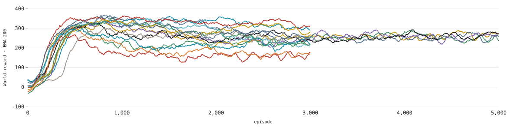
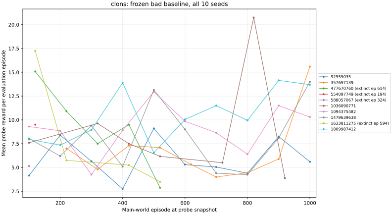
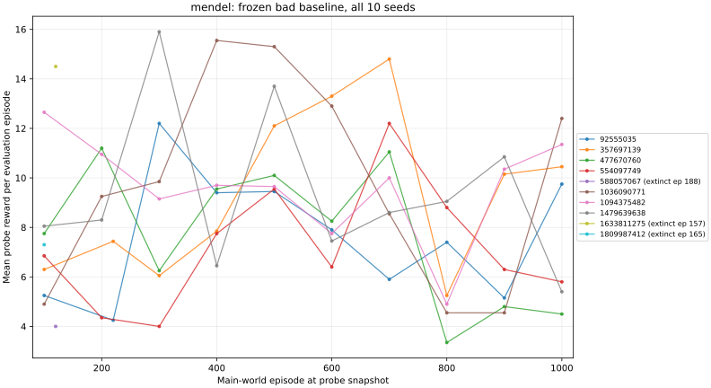
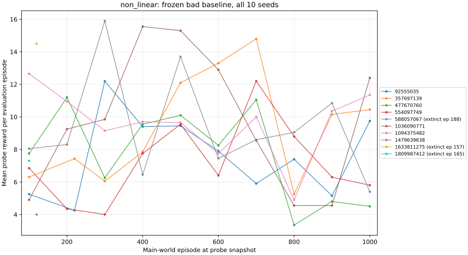
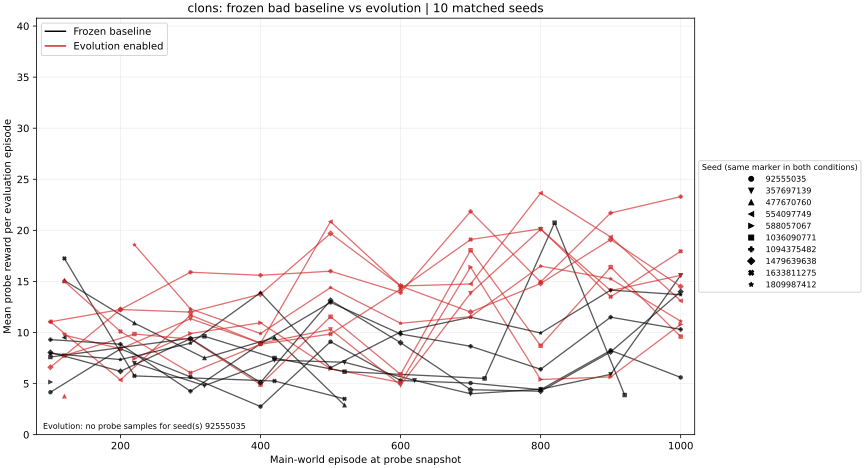
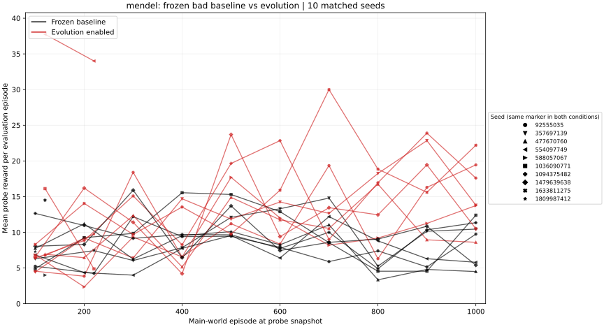
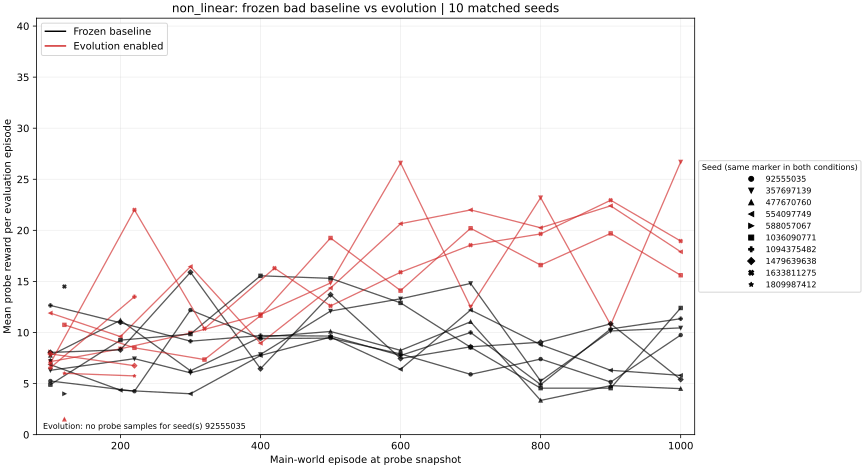

# Which Hyperparameter Inheritance Mechanisms Give Rise to Increasingly Optimized Agents?
# **Abstract**

This paper asks which mechanism for inheriting the hyperparameters of learning agents produces the most optimized agents - by environment reward - in a resource-limited artificial-life setting. In a single 64x64 gridworld with one agent type (a model-free Double DQN with a replay buffer, epsilon-greedy exploration, curiosity, gradient clipping, and a target network) and energy-based rules for life, reproduction, and death, three inheritance schemes are compared: single-parent cloning with mutation (clones), two-parent BLX-alpha blending (non_linear), and a diploid, Mendel-inspired scheme with dominance (mendel). Runs start from deliberately handicapped genes: the main evolutionary runs use 100-150 seeds per mechanism and run for 2000 episodes. Quality is measured by an isolated single-agent probe test (probe-score) and by population survival; a separate no-evolution baseline was also run, with 10 seeds per mechanism.

On probe-score the order is non_linear > mendel > clones; on survival, clones outperforms both two-parent mechanisms. After a Bonferroni correction across the six headline pairwise comparisons (three on probe-score, three on survival; alpha = 0.05/6), only one confidence interval stays positive: non_linear vs. clones on probe-score. That is the single most convincing and robust result in this work. The remaining directional differences - mendel over clones and non_linear over mendel on probe-score, clones over mendel and clones over non_linear on survival - do not survive the correction. Their direction is consistent across different analysis subsets and mechanistically plausible, but they should be read as working hypotheses that need confirmation on independent data, not as established results. The no-evolution baseline shows no sustained growth in probe reward.

Limitations: a single environment, a fixed sigma held outside selection, a single agent type, genes that can only retune values inside an existing paradigm, and hundreds rather than thousands of agents. The results support the stated ordering as an observed trend; the most convincing and robust result is the advantage of non_linear over clones on probe-score. The next step is a transfer test in a harder environment.

# **Introduction**

The central research question is which reproduction mechanism is most likely to produce higher-performing agents - that is, which mechanism for inheriting the hyperparameters of learning agents yields the most optimized agents in this environment.

The study is situated within three lines of prior work. Population Based Training (PBT) is an engineering tool for fast hyperparameter tuning: it copies a selected model and perturbs its hyperparameters, which amounts to single-parent copying with performance-based selection, but it does not structurally combine the genes of two parents, nor does it place agents in an ecology with a depletable resource. Hamon, Nisioti, and Moulin-Frier (2023) showed that neuroevolution also works in a continuous, non-episodic, ecologically grounded setting - one where agents live by energy rules with no explicit fitness function. And Kim and Fernandes (2009), studying ploidy and recombination on a model of the segment polarity network (SPN), explain why combining diploidy with sexual recombination speeds up evolution and raises robustness: "survival of the compatible."

Building on these studies, this work addresses a comparative question about inheritance mechanisms - ploidy, recombination, sexual versus asexual reproduction - inside an ecological artificial-life setup. In one resource-limited environment I compare three schemes for inheriting hyperparameters - clones, non_linear, and mendel - judging them by behavior quality in a single-agent probe test and by population survival.

# Related work

### **Population Based Training of Neural Networks (Jaderberg et al., 2017)**

[Original paper](https://arxiv.org/abs/1711.09846)

PBT is an engineering approach to hyperparameter optimization. A lower-performing model copies the weights and hyperparameters of a selected higher-performing model, after which the hyperparameters are perturbed. That is asexual copying, structurally unable to take good genes from two different parents and combine them: "copy the best" is not the same as "combine the two best." Selection in PBT does not always mean global ranking of the whole population - in the original paper that is specifically how truncation selection works, one of several selection variants. There are others: t-test selection and binary tournament compare a model against one randomly chosen other model, and the algorithm overall is asynchronous. The more precise contrast with this work is this: PBT is an explicit comparison of model performance followed by copying one of them, whereas here reproduction is triggered by a local energy rule (energy > X, reproduce), which depends only on the agent's own state, and hyperparameters are inherited without transferring weights. Local rules produce a different dynamic - spatial niches, coexistence, frequency-dependent effects - that explicit performance comparison does not reproduce. PBT also runs on a fixed, managed population with no ecological embedding, while here there is a shared depletable resource, competition, carrying capacity, birth, aging, and death. Finally, PBT tests one method across different tasks, while I compare several different ways of passing on genes - ploidy, recombination, sexual versus asexual.

### **Hamon, Nisioti & Moulin-Frier (2023), "Eco-evolutionary Dynamics of Non-episodic Neuroevolution in Large Multi-agent Environments."**

[Original paper](https://arxiv.org/abs/2302.09334)

The authors note that most classical neuroevolution (NE) methods and AI simulations omit some properties of biological evolution: they run episodically (the world resets to initial conditions after every "generation") and select agents using explicit fitness functions (rewards/fitness) rather than inside a continuous ecosystem with limited resources where population and environment shape each other. In response, they built a large continuous simulation - non-episodic, with no resets of generations or environment - on the JAX engine, where thousands of agents controlled by recurrent LSTM-memory networks live together in a space with limited resources. Agents have no abstract "rewards": they die or reproduce according to energy-state rules - they eat resources, accumulate energy under a minimal-criterion rule, reproduce once energy is high enough, and die once it runs out. The authors show that neuroevolution can work successfully under such "wild," ecologically valid conditions: the system spontaneously produces complex boom-and-bust population cycles depending on resource density, and agents develop stable collective foraging strategies.

### **Kim & Fernandes (2009), "Effects of Ploidy and Recombination on Evolution of Robustness in a Model of the Segment Polarity Network."**

[Original paper](https://journals.plos.org/ploscompbiol/article?id=10.1371/journal.pcbi.1000296)

The authors take on a classic question in evolutionary biology: why do most complex organisms carry a double set of chromosomes (diploidy) and reproduce sexually (with recombination)? Mathematically, sex is a "double tax" - half the population are males, and recombination breaks up successful gene combinations - yet nature kept it anyway. As their model they used a real biological system from fruit-fly embryogenesis, the segment polarity network (SPN), a five-gene network that has to produce a sharp striped pattern on the embryo's body. Genes were encoded as binary strings (bits standing in for molecular protein binding), and the network's evolution was simulated across generations under selection pressure; haploids (single set) were compared with diploids (double set), and asexuals with sexual organisms (with crossover). Organisms combining a double chromosome set with sexual recombination evolve substantially faster and reach maximal robustness - resistance to mutation and genetic noise. Recombination, in effect, acts as a hard filter for "survival of the compatible": the alleles that win out are not necessarily the ones that are strong on their own, but the ones that work well alongside the widest range of genetic partners, which pushes genes toward becoming general-purpose and reliable. This robustness finding holds within the conditions of their specific SPN model; the review above does not claim to be an exhaustive survey of the ploidy/recombination literature - the three papers above were picked as reference points for this comparison.

# Contributions

I build on three lines of work: PBT (inheriting training hyperparameters), Hamon (an ecological setup with a continuously living population), and Kim & Fernandes (comparing ploidy and sexual/asexual reproduction).

In this work I compare three schemes for inheriting the hyperparameters of learning agents: single-parent cloning with mutation, two-parent BLX-alpha blending, and a diploid, Mendel-inspired scheme with dominance. The comparison runs in one resource-limited environment, judged by behavior quality in a single-agent probe test and by population survival.

# Methods: world and agent description

### Environment (env)

The environment is a simple 64x64-cell gridworld, where 15% of cells initially contain "red" objects and 15% contain "green" objects. On contact, an agent turns such a cell empty. Resources refresh every 5 steps.

+ Red cells are worth -5 reward/energy.
+ Green cells are worth +5 (the evaluation uses external reward rather than shaped reward. During training, negative external reward remains -5, while positive external reward is mapped to +10 to encourage resource collection. Curiosity is added to the internal training reward, including when external reward is negative. External reward remains ±5; the probe-score is calculated from this external reward, not from the shaped training reward).
+ The agent's field of view is an 11x11 square: 5 cells in each direction plus the center cell. The config says `view_size: 10`, but the code computes the radius as `10 // 2`, so the actual side length is 11.
+ The 64x64 environment replenishes as follows:
	- Target level: 15% food and 15% danger cells, roughly 614 cells of each type.
	- Every 5 steps the shortfall in food and danger cells is checked separately.
	- Food: at most 30 cells are added per refill, so it does not necessarily return to 15% right away.
	- Danger cells: replenished to the 15% target, if enough empty space is available.
	New objects appear in random empty cells, excluding agent positions. Existing cells persist - the whole map is never regenerated from scratch.

### Agent

Every world uses a single agent type: a model-free Double DQN with a replay buffer and mini-batching, argmax action selection with epsilon-greedy exploration (epsilon decay), curiosity, gradient clipping, and a target network. The probability of a large mutation on any given gene is set by sigma = 0.05; a mutation multiplies the gene by a factor roughly between 0.5 and 2 (up to twice as large or twice as small).

Each gene in the config has a numeric type (float/int) that only affects the phenotype. The genotype is always stored and passed on as is: if the genotype encodes, say, 3.5 hidden layers, the genotype itself never changes, only the phenotype rounds to an int. Rounding follows the standard Python rule (round half to even): 2.5 rounds to 2, 3.5 rounds to 4. This produces a cumulative effect - a genotype of 3.3 shows up in the phenotype as 3 but stays 3.3 internally, and only once it crosses the 3.5 threshold does the phenotype become 4. Rounding the phenotype never rewrites the genotype, but a handful of separate guardrails on specific genes (see Limitations) do sometimes change the genotype. Genes that are float by nature (learning_rate, gamma, and others) stay float in the phenotype too.

### Energy and life

Every tick an agent pays a base energy cost (energy_leak = 0.3, before accounting for aging). An energy value of 0 (start_energy) is assigned only to the very first, founder agents introduced at initialization; this parameter only applies to them and is no longer used for their children. Energy accumulation is capped at 300 (max_energy). Once an agent accumulates 100 units (reproduction_threshold), it has a child; the parents transfer 80 energy units to the child (reproduction_cost) - that is exactly what the newborn starts life with. Childhood lasts at most 1500 steps (max_childhood_steps), but reproduction ends it sooner; an adult dies once its energy drops to -20 (death_energy) or below.

The leak only grows during adulthood: once an agent becomes an adult, every 200 steps lived adds 0.05 to its personal leak. During childhood this addition stays at its baseline level and never accumulates.

### Choosing a partner

At each tick, agents eligible to reproduce - agents with energy at or above `reproduction_threshold` - takes part in reproduction. They are paired off two at a time, in order; if an odd one is left over, it waits for the next tick, when another eligible agent becomes available in the ordered list.

Energy is the only criterion; distance between agents is deliberately not used. Pairing by proximity would select for exactly the one thing this world already has too much of - spatial clustering, since a crowd is where a partner is always within reach, while a good forager working an empty stretch of map would never find one.

### Inheritance schemes

Three schemes for reproducing the genome are compared. Weights are never passed to offspring in any of them; only hyperparameters are inherited.

#### **non_linear: BLX-α blending**

Each parent carries a single genotype variant (no dominance); when a child is created, genes combine by the formula
$$\text{child}_i \sim \mathcal{U}\big[\min(\text{mom}_i,\text{dad}_i) - \alpha d,\ \max(\text{mom}_i,\text{dad}_i) + \alpha d\big]$$
where `d = hi - lo`, `lo = min(mom_genotype[gene_name], dad_genotype[gene_name])`, `hi = max(...)`, and `alpha = 0.5` sets how far outside the parents' range a child can land. On top of that, a gene can mutate with probability sigma, growing or shrinking by up to a factor of two.

#### **mendel: diploid Mendel-inspired inheritance**

Each cell describes one gene (any parameter value - say, a hidden-layer count) and carries an `A/a` flag (dominant/recessive). A child is assembled at random: for each cell, a random allele is drawn from the matching cell in each parent (say, `a` from the mother and `A` from the father). The phenotype follows: `Aa`/`aA` expresses `A`; if both parents contributed the same dominance (`AA` or `aa`) but different numeric values for the gene (say `{"A", 124}` and `{"A", 141}`), one of the two is picked at random. Mutation in mendel runs through two independent channels, each with probability sigma = 0.05: separately, the numeric value of one chosen allele can change (as in non_linear), and separately, the A/a flag of one chosen allele can flip (A<->a). For a gene under evolution, the chance of at least one of these two channels firing is not sigma, it is about 9.75%; frozen genes are never mutated.

#### **clones: single-parent copying**

The simplest variant: an agent carries its own genotype and, once it has accumulated sufficient energy, spawns a clone; mutation can still happen with probability sigma. The cost of having a child is fixed and identical across every world. Since a clone's single parent pays the full cost while a sexual pair splits it between two parents, a clone parent pays as much as the two sexual parents pay combined: each of the two sexual parents contributes 40, a clone parent contributes 80, and in every world the child is born with 80. That keeps the total cost of one child the same everywhere; otherwise reproducing in the clone worlds would be twice as cheap.

# Experimental setup

### Life cycle

Life splits into two periods: childhood, where an agent is immortal and learning, and adulthood, where it can die. Childhood ends once `max_childhood_steps` is reached, but reproduction ends it sooner. Life is capped from above by aging: the older an agent gets, the more energy it burns. Death is purely energetic (starvation) and happens once energy drops to -20 or below.

### Comparison design

The design isolates, above all, the sexual-versus-asexual axis (clone versus the two two-parent schemes). That isolation is not entirely clean, though: mendel differs from non_linear along two axes at once, both ploidy and recombination change, and the same holds for the clones/non_linear and clones/mendel pairs. So what is really being compared is bundles of mechanisms rather than the isolated effect of any single reproduction mechanism on its own. The comparison rests on three types of runs that differ in length and purpose: the main evolutionary runs with probe evaluation, short survival tests, and a separate no-evolution baseline. Number of worlds by type:

| Run type | clones | mendel | non_linear |
| --- | ---: | ---: | ---: |
| With evolution and probe, planned 2000+ episodes | 100 | 150 | 150 |
| Short survival tests, planned 500 episodes | 200 | 200 | 200 |
| New no-evolution baseline, planned 1000 episodes | 10 | 10 | 10 |
| Total worlds | 310 | 360 | 360 |

The main runs last 2000 episodes: pilot observations suggested that parameter changes largely plateaued after approximately 500-1000 episodes; the remaining interval was used to examine whether improvement persisted.



Runs start from deliberately handicapped genes:

| gene | start | good |
| --- | --- | --- |
| hidden_size | 40 | 64 |
| buffer_size | 1000 | 10 000 |
| gamma | 0.50 | 0.99 |

On one pilot run (seed 1290435116), starting this way, agents learned at roughly 35-40% of the good-baseline speed, entered adulthood at roughly 44% lower reward, and recovered to the environment's ceiling by around episode 300; there is no strict definition of "learning speed" here, nor an aggregate across all seeds, so these numbers are illustrative rather than a property of the whole sample.

### Probe evaluation

Every 100 episodes, 5 agents are pulled from the world (copying them does not affect the main world). Once a run finishes completely, each of those agents gets its own fresh map - with food and danger cells, on the same seed and under the same replenishment rules as the main run - where it lives alone: metabolism, reproduction, and network training are all switched off, and it simply acts in the world and collects reward (epsilon and curiosity keep decaying on their usual schedule). Probe worlds give a nearly clean measurement in isolation, free of competition, noise, and the balance of a populated world: in a populated world, the average reward across adult agents stays roughly constant, which makes it hard to draw conclusions, whereas a probe isolates intelligence specifically. A small amount of noise still remains - randomness and the agent's learning history up to the snapshot do not disappear, though the randomness itself is controlled through rng/seed.

### Operational definition of optimization

The main criterion is env reward - reward from the environment that ignores internal reward shaping, curiosity, and the like. I track its growth: growth rate, peak, stability, population average.

### Main metric and success criterion

There could be many metrics, but since what is under study is agent intelligence, there is one key one: env reward. I look at its curve - average value, peak, and shape (how fast it rises, whether it later falls, how stable it is). Success criterion for the main metric: the result has to beat baseline.

### Hypotheses

1. Ploidy should not matter much in this environment: it matters in changeable environments, where something that used to be useless can suddenly pay off once the rules shift, and here the rules essentially never change, so carrying an extra pair of genes is not that important. That would change the moment the environment itself became changeable.
2. Clones have an obvious advantage, no need to find a partner, but I would still expect clones to lose to both sexual versions, because their genetic variation is weaker: only a small chance of an aggressive mutation, whereas sexual agents, especially non_linear, can shift genes by small amounts and ease their way toward the optimum.
3. Together, these two hypotheses suggest that non_linear should turn out the most effective in this environment.

## Computing the metrics

- One episode of the main world is 20 steps; the environment itself does not reset - my world is non-episodic, and splitting it into episodes is purely for convenience of analysis and counting;
- for probe, each snapshot draws random adult agents; if there are fewer than 5, one retry happens 20 main episodes later, and if adults are still short, whatever is available gets used; if there are no adults at all, no snapshot is taken. A single agent's run is 20 probe episodes of 20 steps each (400 steps);
- the main probe metric is an agent's total external reward over those 20 probe episodes, averaged over the snapshot's selected agents and then over the last three available snapshots no later than step 40000 (the Baseline section instead uses reward per single probe episode, the same quantity divided by 20);
- probe intervals are computed from paired differences via the t-distribution; pairwise comparisons are conditional on both worlds in a pair surviving to the step being compared;
- survival is computed from the main runs (2000 episodes) and, when data fell short, from dedicated shorter runs of 500 episodes. Across a sample of 400 probe worlds, 137 of 139 observed extinctions (98.56% of observed extinctions, not of all worlds) happen by ep500, so running four times as many full-length worlds would have been unnecessary for the chosen survival horizon; later deaths do occur (for example, clones seed 193016383 at ep809.4; mendel seed 1793918713 at ep502.25);
	- **in every run, survival is evaluated at step 10,000 (episode 500), regardless of how long the run actually lasted**

### Formulas

1. Total probe reward for one agent: $R_a=\sum_{t=1}^{400}r^{env}_{a,t}$
2. Mean reward across agents in one snapshot: $S_k=\frac{1}{Q_k}\sum_{a=1}^{Q_k}R_a$
3. A world's probe-score from its last three snapshots before ep2000: $S_w=\frac{S_1+S_2+S_3}{3}$
4. Probe reward per single evaluation episode, the unit used on baseline plots: $S_{k,\text{per episode}}=\frac{S_k}{20}$
5. Paired difference on one seed: $d_i=S_{A,i}-S_{B,i}$
6. Mean difference: $\bar d=\frac{1}{n}\sum_{i=1}^{n}d_i$
7. Sample standard deviation: $SD(d)=\sqrt{\frac{\sum_{i=1}^{n}(d_i-\bar d)^2}{n-1}}$
8. Standard error of the mean difference: $SEM=\frac{SD(d)}{\sqrt n}$
9. MoE and 95% CI for probe differences: $MoE=t_{0.975,n-1}\cdot SEM$, $CI_{95\%}=[\bar d-MoE;\ \bar d+MoE]$
10. Count and share of differences above a chosen threshold c: $N_{>c}=\sum_{i=1}^{n}I(d_i>c),\qquad P_{>c}=100\frac{N_{>c}}{n}$. Used thresholds: $c=0$, $30$, $60$.
11. Survival by ep500: $X_{A,i}=I(N_{A,i}(10000)>0)$, $\hat p_A=\frac{\sum_iX_{A,i}}{n},\qquad \text{survival percentage}=100\hat p_A$
12. Paired survival difference: $d_i=X_{A,i}-X_{B,i}$, $\Delta_{\text{pp}}=100\bar d$
13. Paired SEM for survival: $SEM_{\text{pp}}=100\frac{SD(d)}{\sqrt n}$. Equivalently, with $n_+$ worlds where only A survived and $n_-$ where only B survived: $SEM_{\text{pp}} =100\sqrt{ \frac{n_++n_--(n_+-n_-)^2/n}{n(n-1)} }$
14. MoE and 95% CI for survival in the final tables: $MoE_{\text{pp}}=1.959964\cdot SEM_{\text{pp}}$, $CI_{95\%,\text{pp}} =[\Delta_{\text{pp}}-MoE_{\text{pp}};\ \Delta_{\text{pp}}+MoE_{\text{pp}}]$
15. SE for independent proportions, used in earlier summaries, not in the final paired calculation: $SE_{\text{ind}} =\sqrt{\frac{\hat p_A(1-\hat p_A)}{n_A} +\frac{\hat p_B(1-\hat p_B)}{n_B}}$, $CI_{95\%}=(\hat p_A-\hat p_B)\pm 1.96\, SE_{\text{ind}}$

# Results

## probe-score (reward)

Relative mean gains below are calculated as $100(\bar S_A-\bar S_B)/\bar S_B$, using the means of the two mechanisms on the same comparison set. They describe a percentage difference between means, not the mean of seed-level percentage differences. Absolute differences and confidence intervals remain in probe-score units; percentages are rounded to one decimal place.

**non_linear vs. clones.** Among worlds that jointly survived to episode 2000, non_linear shows a higher mean probe-score than clones: 95% CI **[+29.7, +77.8]**, mean difference +53.759 (approximately +15.7% relative to the clones mean on the same seeds). Share of positive differences: >0, 41/58 (70.7%); >30, 37/58 (63.8%); >60, 27/58 (46.6%).

**mendel vs. clones.** There is evidence of a higher mean probe-score for mendel over clones, though the result is less convincing than non_linear's advantage over clones: CI **[+2.0, +55.5]**, mean difference +28.739 (approximately +8.5% relative to the clones mean on the same seeds). On a comparable amount of data, mendel shows a substantially smaller gap than non_linear (**[+2.0, +55.5]** versus **[+29.7, +77.8]**): the lower CI bound barely clears zero, the range skews positive, and the mean benefit is smaller (28.739 versus 53.759).

**non_linear vs. mendel.** Mean difference +32.023 (approximately +9.0% relative to the mendel mean on the same seeds), CI **[+7.406, +56.640]**. Share of positive differences: >0, 32/59 (54.2%); >30, 25/59 (42.4%); >60, 20/59 (33.9%). The result is visible, if weaker than the non_linear-versus-clones pair.

### non_linear > mendel > clones

The pairwise comparisons point to the order non_linear > mendel > clones. To assess sensitivity to the composition of the comparison set, the same outcomes are compared on seeds where not just two but all three reproduction types overlap (the numbers shift a little, but what matters is whether the direction holds).

Shared seeds: **35**. All three worlds survived to episode 2000 and have three probe snapshots no later than step 40000. Each world's metric is the mean across agents within a snapshot, then across the last three snapshots.

**mendel vs. clones (`mendel - clones`).** On average, mendel scores higher than clones: the mean difference came to $+25.333$ (approximately +7.5% relative to the clones mean on these 35 seeds; SD $= 79.887$, SEM $= 13.503$), with a median difference of $+14.667$. Even so, the 95% CI crosses zero: the margin of error (MoE) reached $\pm 27.442$, putting the interval between $-2.109$ and $+52.776$. The difference favored mendel in 21 cases, clones in 14, with no ties.

**non_linear vs. clones (`non_linear - clones`).** non_linear's 95% CI does not cross zero (nominally, without correction): there is a substantial edge over clones. The mean difference between them came to $+62.114$ (approximately +18.5% relative to the clones mean on these 35 seeds; $SD = 90.475$, $SEM = 15.293$); the median was nearly identical to the mean ($+61.667$). With a margin of error of $\pm 31.079$, the 95% CI sits strictly in positive territory, from $+31.035$ to $+93.193$. non_linear beat clones in most observations (26 of 35), losing in only 9 (no ties).

**non_linear vs. mendel (`non_linear - mendel`).** Comparing non_linear and mendel, the 95% CI likewise does not cross zero (nominally, without correction): a shift in favor of the first method. The mean difference of $+36.781$ (approximately +10.2% relative to the mendel mean on these 35 seeds) sits well above the median of $+6.667$; the plot shows that a few large positive differences pull the mean advantage for non_linear upward. Despite a wide margin of error ($\pm 34.470$), the 95% CI still clears zero, running from $+2.311$ to $+71.251$. The difference favored non_linear in 19 cases, mendel in 14, and tied in 2.

| Difference | All matching pairs: mean (relative gain) and CI | Triple intersection: mean (relative gain) and CI |
| --- | --- | --- |
| mendel - clones | +28.7 (+8.5%) [ +2.0, +55.5 ] | +25.3 (+7.5%) [ -2.1, +52.8 ] |
| non_linear - clones | +53.8 (+15.7%) [ +29.7, +77.8 ] | +62.1 (+18.5%) [ +31.0, +93.2 ] |
| non_linear - mendel | +32.0 (+9.0%) [ +7.4, +56.6 ] | +36.8 (+10.2%) [ +2.3, +71.3 ] |

All the means keep the same sign, and the values are fairly close: for mendel - clones the mean difference shifted by only about 3.4 units.

**The observed mean probe-scores line up with the order non_linear > mendel > clones. That order holds both in the main pairwise comparisons and in the shared 35-seed set. non_linear's advantage over clones comes through most convincingly. The non_linear-mendel mean difference is also positive in both analyses, though the advantage is not uniform across seeds. The evidence for mendel's advantage over clones is less convincing: on the triple intersection, the confidence interval includes zero. So the results support the stated ranking as an observed trend, but they do not establish every link in that chain with equal confidence. Every interval reported here is nominal, with no correction for multiple comparisons or for sequential examination of the data.**

## Survival

This section pools every evolutionary run, the main ones (with probe) together with the short survival tests, giving 300 worlds for clones and 350 each for mendel and non_linear; the no-evolution baseline is not included here.

| Mechanism | Survived | Total worlds | Survival |
| --- | ---: | ---: | ---: |
| clones | 235 | 300 | 78.333% |
| mendel | 231 | 350 | 66.000% |
| non_linear | 243 | 350 | 69.429% |

| Pair: first - second | Shared seeds | Survived: first | Survived: second | Difference, pp | SEM, pp | MoE (95%), pp | 95% CI, pp |
| --- | ---: | ---: | ---: | ---: | ---: | ---: | --- |
| clones - mendel | 300 | 235/300 (78.333%) | 206/300 (68.667%) | +9.667 | 3.780 | ±7.410 | [+2.257, +17.076] |
| clones - non_linear | 300 | 235/300 (78.333%) | 214/300 (71.333%) | +7.000 | 3.124 | ±6.123 | [+0.877, +13.123] |
| non_linear - mendel | 350 | 243/350 (69.429%) | 231/350 (66.000%) | +3.429 | 3.429 | ±6.720 | [-3.291, +10.148] |

For the clones-mendel and clones-non_linear pairs the whole interval stays positive, while for non_linear-mendel the interval includes zero. So clones shows higher observed survival than either two-parent mechanism: the nominal pairwise 95% CIs for these differences do not include zero, though the intervals do not account for sequential examination or multiple comparisons. The survival difference between non_linear and mendel stays undetermined.

## Correcting for multiple comparisons

This is an exploratory study; the amount of data grew as results were checked along the way. The correction applied to the final comparisons below does not fully account for that process of sequential sample expansion.

Several times above I have flagged that the reported 95% CIs are nominal and uncorrected for multiple comparisons. I am treating all six comparisons as one family rather than splitting them into k=3 for probe-score and k=3 for survival, because both groups are presented in the Abstract and Conclusion as independent directional claims, each with its own confirmed/not-confirmed verdict - this choice controls the risk of a false positive across every directional claim in the paper at once, and it is more conservative than correcting each metric separately (which would be an equally defensible choice if probe-score were treated as the primary endpoint and survival as secondary). Let us check this explicitly on the paper's six headline pairwise comparisons - three on probe-score (non_linear-clones, mendel-clones, non_linear-mendel) and three on survival (clones-mendel, clones-non_linear, non_linear-mendel) - applying a Bonferroni correction: alpha = 0.05/6. For probe, the t-based calculation still applies: $CI=[\bar d-t_{1-0.05/(2\cdot6),n-1}SEM;\ \bar d+t_{1-0.05/(2\cdot6),n-1}SEM]$. The critical t-multipliers come to roughly 2.73346 (n=58, non_linear-clones), 2.75993 (n=46, mendel-clones), and 2.73177 (n=59, non_linear-mendel). The probe intervals below were recomputed from the row-level data published in the Supplementary Material. For survival, the normal approximation used elsewhere still applies, with $z_{1-0.05/(2\cdot6)}\approx2.63826$ instead of 1.959964.

| Comparison | Plain CI | CI after Bonferroni (x6) |
| --- | --- | --- |
| non_linear - clones (probe) | [+29.7, +77.8] | [+21.0, +86.5] - **excludes zero** |
| mendel - clones (probe) | [+2.0, +55.5] | [-7.9, +65.4] - includes zero |
| non_linear - mendel (probe) | [+7.4, +56.6] | [-1.6, +65.6] - includes zero |
| clones - mendel (survival) | [+2.3, +17.1] | [-0.3, +19.6] - includes zero |
| clones - non_linear (survival) | [+0.9, +13.1] | [-1.2, +15.2] - includes zero |
| non_linear - mendel (survival) | [-3.3, +10.1] | includes zero even without correction |

After correcting for six final comparisons, a positive confidence interval survives for only one: **non_linear - clones on probe-score**. The most convincing and robust result is non_linear's advantage over clones on probe-score; that is not the same as strict confirmation once the whole sequential-sampling process is taken into account. The remaining directional differences - mendel > clones and non_linear > mendel on probe-score, plus both directional survival differences (clones > mendel, clones > non_linear) - do not survive the correction. Their direction is consistent across different analysis subsets and mechanistically plausible (see Discussion), but they do not meet the corrected criterion: these are working hypotheses that need confirmation on independent data, not established differences.

## No-evolution baseline: probe overview

**Units:** probe reward per episode = each isolated agent's total external reward over 20 probe episodes, divided by 20, then averaged across the snapshot's selected agents. The horizontal axis is episodes of the main training run, a different scale from the 20 episodes of the isolated evaluation. To compare against the earlier tables of total probe reward, multiply these values by 20.

All 10 seeds for each mechanism are included, extinct worlds too. After extinction, probe reward is not backfilled with zero; there are simply no further measurements. Each window's average includes only available measurements, so N can vary.

A snapshot was sometimes pushed back by 20 episodes for lack of adults. The table merges the planned point K with its rescue snapshot K+20; the actual range and N are shown. On the plots, each seed's curve uses its actual snapshot times.

The tables for mendel and non_linear below match - that is not a copy-paste error, it is a real result. With genes fully frozen, every founder carries the same fixed values, so for mendel equal alleles on every gene make the choice of allele and dominance indistinguishable, and for non_linear blending identical parental values just returns the same value; with identical randomness in the world and in training, that produces identical dynamics on the same seed.

### clones

Reached episode 1000: **6/10**.

| Planned episode | Actual snapshot episodes | N seeds | Mean probe reward per episode |
| --- | --- | ---: | ---: |
| 100 | 100-120 | 9 | 9.337 |
| 200 | 200-220 | 7 | 7.781 |
| 300 | 300-320 | 7 | 7.168 |
| 400 | 400-420 | 8 | 7.525 |
| 500 | 500-520 | 8 | 7.672 |
| 600 | 600-620 | 5 | 7.902 |
| 700 | 700-720 | 6 | 6.517 |
| 800 | 800-820 | 6 | 8.367 |
| 900 | 900-920 | 6 | 8.629 |
| 1000 | 1000-1000 | 5 | 11.840 |



### mendel

Reached episode 1000: **7/10**.

| Planned episode | Actual snapshot episodes | N seeds | Mean probe reward per episode |
| --- | --- | ---: | ---: |
| 100 | 100-120 | 10 | 7.755 |
| 200 | 200-220 | 7 | 7.962 |
| 300 | 300-300 | 7 | 9.057 |
| 400 | 400-400 | 7 | 9.464 |
| 500 | 500-500 | 7 | 11.407 |
| 600 | 600-600 | 7 | 9.136 |
| 700 | 700-700 | 7 | 10.157 |
| 800 | 800-800 | 7 | 6.186 |
| 900 | 900-900 | 7 | 7.450 |
| 1000 | 1000-1000 | 7 | 8.521 |



### non_linear

Reached episode 1000: **7/10**.

| Planned episode | Actual snapshot episodes | N seeds | Mean probe reward per episode |
| --- | --- | ---: | ---: |
| 100 | 100-120 | 10 | 7.755 |
| 200 | 200-220 | 7 | 7.962 |
| 300 | 300-300 | 7 | 9.057 |
| 400 | 400-400 | 7 | 9.464 |
| 500 | 500-500 | 7 | 11.407 |
| 600 | 600-600 | 7 | 9.136 |
| 700 | 700-700 | 7 | 10.157 |
| 800 | 800-800 | 7 | 6.186 |
| 900 | 900-900 | 7 | 7.450 |
| 1000 | 1000-1000 | 7 | 8.521 |



### Matched-seed comparison with evolution enabled







### Baseline observations

**There is no sustained, consistent growth in mean probe reward in the baseline:**

- clones mostly oscillates between about 6.5 and 9.3, with an uptick at the last point;
- mendel/non_linear oscillate between 6.2 and 11.4, ending at 8.5.
- it is also visible that with evolution switched on, reward is higher than baseline in most snapshots.

At exact matches of seed and measurement episode, when comparing against worlds on the same seeds with evolution switched on, the picture is:

| Mechanism | Comparable snapshots | Evolution higher | Equal | Evolution lower |
| --- | ---: | ---: | ---: | ---: |
| clones | 34 | 28 | 1 | 5 |
| mendel | 47 | 31 | 0 | 16 |
| non_linear | 28 | 24 | 0 | 4 |

These are descriptive counts, not independent statistical replicates - several snapshots belong to the same seed. At episode 1000, clones has four comparable seed-level differences in probe-reward-per-episode: +13.0, +0.5, -2.6, 0.0 - so evolution's edge is not universal on every single seed, even though it favors evolution in most snapshots.

### Limitation of the baseline comparison

+ The evolutionary runs had variation among founders, while the baseline is uniform: the fixed baseline gives every founder the mean value of each gene, while an evolutionary run draws a random sample from the distribution around those same settings. The values match on settings/centers, not on the actual starting genomes, and both the initial genetic variation and the subsequent evolution change at the same time, so this comparison does not isolate the causal effect of turning evolution on by itself, apart from the spread among founders.

# Discussion

The observed order non_linear > mendel > clones is consistent with the mechanism behind each scheme, but of the three pairwise differences that make up that order, only non_linear - clones keeps a positive confidence interval after correcting for multiple comparisons (see "Correcting for multiple comparisons" above); mendel > clones and non_linear > mendel remain working hypotheses.
The following provides a possible mechanistic interpretation of the observed ordering, rather than a separately established causal explanation. non_linear and mendel recombine parental values, potentially providing additional routes through parameter space, whereas clones is a more straightforward way to reproduce: there is no such room, and movement toward the goal comes only in mutation events. mendel, in turn, does not interpolate a numerical gene value "between" the parents: it expresses one of the two inherited alleles, which leaves less room for fine-tuning and makes it more dependent on how the world was seeded initially. non_linear, by contrast, can shift values smoothly and, as a normal part of its mechanism, land outside the parents' range, not just through mutation. These are the same considerations I use to explain why non_linear's advantage over clones is the most pronounced, and mendel's advantage over clones the weakest.

On the baseline: evolution, as far as the available data goes, is associated with a noticeable gain in "intelligence," though this work does not isolate that effect causally in any strict sense. In the baseline, evolution is switched off, and the settings (distribution centers) for the starting genes match the evolutionary runs, but the actual starting genomes do not match: the baseline gives every founder a fixed mean value for each gene, while in the evolutionary runs founders are drawn at random from that same distribution, so the spread among founders differs between the two conditions. That said, where evolution is switched on, reward is higher than baseline in most comparable snapshots (see the table above), while the baseline itself shows essentially no sustained growth.

With that caveat about founder spread in mind, I read the overall picture, both the mechanism's logic and the basic experiments (10 randomly chosen baseline worlds, of which fewer survived), as a reasonably convincing argument, though not a strictly isolated one, that evolution does produce a gain in this particular environment, rather than as a conclusively, causally proven fact.

# **Conclusion**

(These conclusions sit closer to exploratory than confirmatory - even though I had hypotheses going in, they did not cover most of what the experiments turned up, and the sample was expanded with new seeds multiple times for lack of data.)

1. **Most convincing and robust result:** non_linear > clones on probe-score. Of the paper's six final pairwise comparisons, this is the only one whose confidence interval stays positive after the Bonferroni correction (alpha = 0.05/6). The correction does not fully account for the sequential expansion of the dataset, so the result remains exploratory rather than strictly confirmed once that whole process is taken into account.
2. **Level 2 (suggestive/exploratory):** mendel > clones and non_linear > mendel on probe-score, plus clones > mendel and clones > non_linear on survival. These differences point the same way across different analysis subsets and are mechanistically plausible, but none of them survives a multiple-comparisons correction: treat them as working hypotheses needing confirmation on independent data, not as established results. The survival difference between non_linear and mendel stays undetermined even without any correction.
3. On the baseline: evolution is associated with a noticeable gain in task performance in most comparable snapshots, but the baseline and the evolutionary runs do not isolate that effect from the spread in starting genomes - the question is not settled causally in a strict sense.

# Limitations

1. Only one environment is used.
2. Because non_linear survives less often, comparing surviving worlds is partly shaped by survival selection; different subsets of the data point the same way, but the size of the effect may be biased.
3. What is being compared are whole, bundled implementations - the causes behind the differences are not isolated.
4. The number of deliberately handicapped genes is small, because agents turn out to be highly sensitive to changes; in short, it is hard to weaken the start enough that agents do not simply go extinct while still showing a worse result.
5. Age correlates with probe-score and differs between groups; its specific contribution has not been established separately.
6. Sigma (the probability that any given gene, on mutating, gets multiplied by a factor of roughly 0.5 to 2, that is, changes by up to a factor of two in either direction) is fixed and sits outside natural selection, even though the simulation would technically allow it to evolve. I chose not to let sigma evolve, even though it is technically one of the genes itself, for two reasons: first, it is fundamentally different from the other genes - those mostly act on the agent, while sigma acts on evolution and the genotype itself; second, mutation behavior in artificial life is a well-studied topic that I do not see the point of re-deriving here.
7. Globally, only one agent type is used.
8. Genes that are passed on biologically only retune values inside an existing paradigm and cannot create a new one; they can only push values around within the paradigm that already exists (model-free stays model-free, a new mechanism like model-based never spontaneously appears).
9. Naturalness of selection: I tried to keep checks on whether a gene is valid to a minimum. Genes can end up fairly specific, redundant, or strange - in principle, say, the number of layers could grow to 12334 and nothing would stop it (unlikely in practice, since the baseline sits around 2-5 and getting there would require a long run of upward mutations, but it is not forbidden). Still, at the genotype-creation stage there are guardrails on a handful of specific genes, and the replacement is not always "round to the nearest boundary":
	- gamma, learning rate, sigma, alpha, max_norm, the decay parameters, buffer_size, hidden_layers, batch_size, hidden_size, and target_update_freq each get clipped differently when they fall outside their allowed range. For instance, hidden_size below 1 becomes 30, hidden_layers below 0 becomes 1, batch_size below 1 becomes 10, and a negative learning rate or max_norm becomes 0.0001; that last one matters in particular because a negative max_norm would periodically send training backward, which never once produced high-performing agents, these safeguards also reduce the computational cost of numerically invalid or nonfunctional configurations.
	- There are also upper caps: hidden_size <= 256 and batch_size <= min_buffer_size. hidden_layers has no upper cap - that is a separate gene - and the logs genuinely contain worlds with 0 hidden layers, so a floor of 1 cannot be treated as universal across every "layer-like" gene.
	- Values outside this list that break the code once they exceed their range (errors, hardware overload, and the like) also get clipped, but there is no single "round to the nearest boundary" rule across every gene; each of the genes listed above gets its own specific replacement.

10. Multiple rounds of adding new seeds, to get enough information for analysis.

# AI usage

Full disclosure, since this matters for how the results should be read.

I used Claude and Codex to assist with coding, discuss hypotheses and methodological and statistical questions, check calculations, translate and edit the manuscript, and prepare the final layout. I reviewed the AI-assisted material, developed the main research design, formulated the hypotheses, wrote most of the code, conducted the experiments, and analyzed and interpreted the results. I made the final decisions about the implementation, methodology, and conclusions, and take responsibility for the methods, results, and claims presented in this work.

# Reproducibility

The code supports seeded runs. The seeds, hardware, and library versions used for these experiments are documented in [reproducibility.md](reproducibility%26configs/reproducibility.md) in the research directory of the repository. Reproduction should use the recorded code revision and software configuration.

[https://github.com/vasiliy-cell/Growth.covenant](https://github.com/vasiliy-cell/Growth.covenant)

**commit hash:**
```
c85f5122e6a52c61f9eebf87cc9bcded1af2dfd8
```

# Future work

From here the research could go in one of two directions, or both at once.

The first is a detailed check of how well these results transfer to a harder environment.

The second, more likely direction, is studying the emergence of language: give agents a way to pass symbols or information to each other, and try to get them to develop their own language by making the world harder, adding long-term memory, and setting goals too complex for a single agent to reach alone. That line of research would need to settle a number of separate sub-questions, for instance how to recognize a language and tell it apart from noise, how to make one emerge in the first place, and how to frame a concrete engineering task built around that language (say, solving harder tasks). For now this direction is only sketched out in broad strokes.

----------
